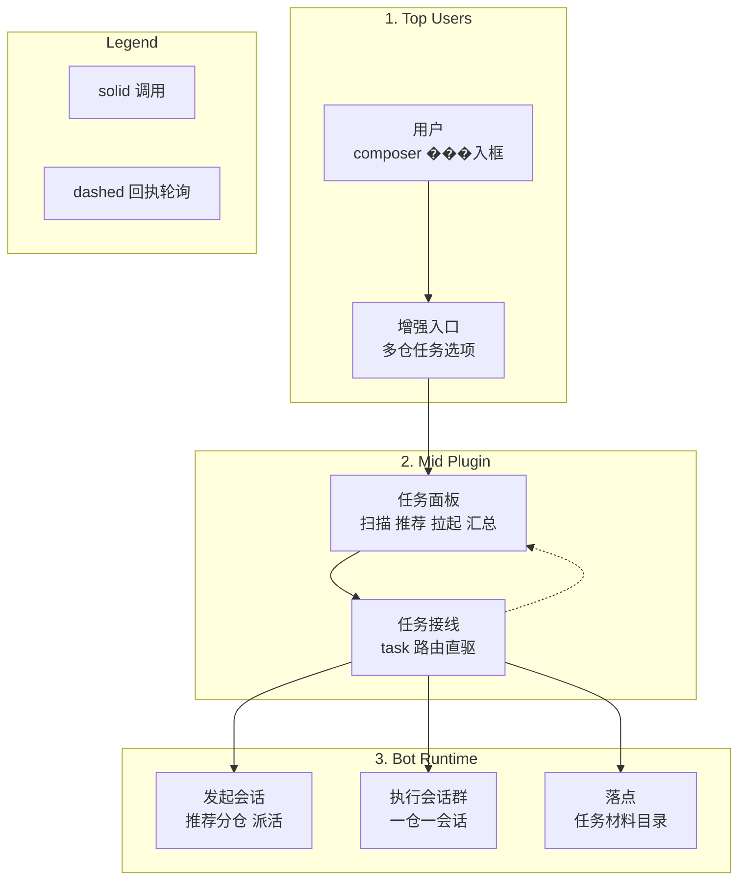
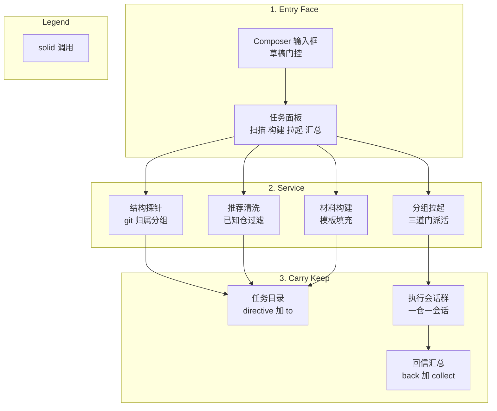
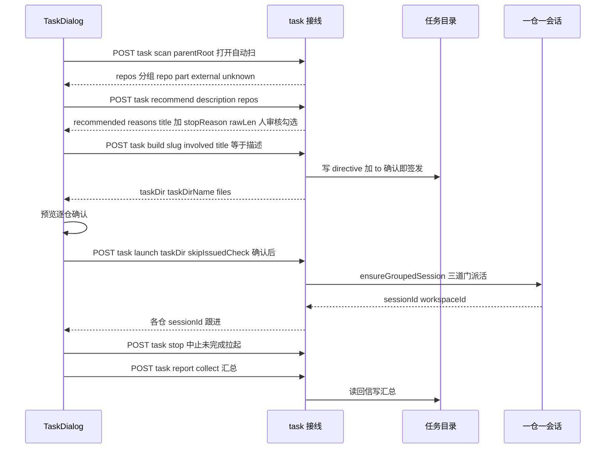

# Cross-tasks Architecture Description

> Provenance: `arch reconcile` from `docs/architecture.md` (2026-10-22); split per request
> into debate / cross-tasks pair. Scope here is cross-tasks only; debate lives in
> `docs/architecture-debate.md`; total view stays in `docs/architecture.md`.
> Zero-invention: every statement traces to `GLOSSARY.md` (multi-repo section),
> `docs/adr/0025`/`0026`/`0028`/`0029`, `docs/efforts/task-recommend/spec.md`,
> or the code in `src/cross_tasks/`, `src/index.ts` (task part),
> `src/client` (task half) and `src/version.ts`.
> Naming: `cross_tasks` is the code directory (`snake_case`, reclaimed after the prototype
> retired, S23); `/api/task/*` + `task_*` keep the public `task` face (breaking boundary);
> `cross-tasks` (kebab) refers only to the retired prototype instance, never to code.

## 1. Identification and Scope

- **System Name**: dsh-session-enhance / cross-tasks subsystem (DSH native plugin
  `elec-session-enhance`, task half).
- **Purpose**: 一父目录下多仓并行推进——扫结构（scan）→ AI 按任务描述推荐涉及仓、
  人审核勾选（recommend，ADR-0028）→ 建任务材料目录（build，人审改 issued）→
  一仓一会话拉起执行（launch）→ 回信汇总（report / collect），见 ADR-0025/0028/0029。
- **Scope**: `src/cross_tasks/` 四纯模块（scan / materials / ensure-session / recommend）+
  `src/index.ts` 内 task 接线（10 条路由 + `taskLaunchControllers`，模型工具零个）+
  `src/client` 任务半区（`✦ 增强会话`菜单 + TaskDialog + `task.ts` 纯逻辑）+
  共用的 `src/version.ts` 与面板外壳。辩论不在本文档内，见 `docs/architecture-debate.md`。
- **One seam**: 纯逻辑（`src/cross_tasks/`，零 IO 或依赖注入，可单测）与 host 接线
  （`src/index.ts`，唯一 tsdown entry 约束，同文件逐条注册）分离。路由直引纯模块
  （same-process wiring，无 facade；TOML `exposed = []`，见 `src/cross_tasks/module.toml`）。

## 2. Stakeholders and Concerns

- **多仓任务发起人（最终用户）**: 一父目录下多仓并行推进，材料人审后再拉会话，不拉空模板会话。
  - **Concerns**: 结构先看清（scan 分组可勾）、材料先审后发（issued 门）、
    一仓一会话可跟进（launch 回 sessionId）、回信可汇总（report / collect）。
- **插件维护者**: probe / recommend / build / launch 各可单测；host 注册失败可观测；
  模板占位没填完不写半成品。
  - **Concerns**: 纯函数 + `FsDeps` / `EnsureDeps` 注入可测；路由契约可查；
    架构漂移被门拦住（PURE-01 / PANEL-01 / WIRE-01 / SYM-01）。
- **DSH 部署**: 插件不得扩权，不得改 preset 文件，不得发包到 prod。
  - **Concerns**: issued 门只拦外部直调；ASCII 门防注入；`standard` preset 全部署。

## 3. Quality Attribute Scenarios (QAS)

- **QAS-7 任务先审后发**: scan 先看清结构（repo / part / external / unknown 分组）；
  打开面板自动扫并推荐（cwd 默认、AI 按任务描述推荐涉及仓 + 理由展示；判不出回空选 +
  提示手勾），用户审核勾选后再 build；"重新扫描"只在换目录时手点；
  build 写材料目录后直接进预览——逐仓列出"仓 → cwd → provider / model"，确认才拉起
  （确认即签发，`skipIssuedCheck` 直发，directive 照常写盘留痕）；stop 能 abort 未完成的拉起
  （已冒出的会话不回收，人去会话列表跟进）。

## 4. Viewpoints and Views

### 4.1 Context View

- **Purpose**: 任务半区在 DSH 里占什么位置：一个 task 接线 + 10 条 HTTP 路由 + 一个任务面板，
  不碰会话主循环。黑盒只讲边界。
- **Model/Diagram**:

- **Elements**: 黑盒外只有三样：发起会话（`task/recommend` 起 one-shot 分仓员）；
  执行会话群（一仓一会话，`ensureGroupedSession` 三道门拉起）；
  落点（`<tasksRoot>/<slug>-<stamp>/` 材料目录 + 回信）。面板只经
  `POST /dsh-session-enhance/api/task/*` 与 host 说话。

### 4.2 Logical Decomposition View

- **Purpose**: 任务半区的职责分层：入口 / 交互 / 服务 / 载体 / 留存。图里只讲职责，
  文件名索引见 Elements。
- **Model/Diagram**:

- **Elements**:
  - `src/cross_tasks/scan.ts`（结构探针，纯逻辑 + 薄 IO，`FsDeps` 注入可测）：
    `scanParent`（输入 parentRoot，输出旗下直接子目录 git 归属）/ `probeGit` /
    `mergeSameGitRoot`（同 git 根归一，首见为主余下进 `aliases[]`）+ `isExternalName` /
    `parseGitdir` / `normalizeKey` / `toRel`。kind 四态：`repo` 独立检出 /
    `part` 父库一部分 / `external` 名单或 junction 跳过 / `unknown` 拿不准让人勾；
    `EXTERNAL_NAMES`（data / `.gm_*` / `.tmp` / node_modules / `.git`）。
  - `src/cross_tasks/recommend.ts`（推荐输出清洗，纯逻辑）：`parseRecommendText`
    （首 `{`…末 `}` 提取；只留扫描已知仓保序去重；理由只留推荐仓；标题截 60 字；
    非法直接抛错，路由回 ok:false）+ `normalizeRepoRef` / `matchRecommended`
    （ADR-0030 写法宽容：大小写/反斜杠/尾斜杠/`./` 前缀/裸仓名都归一到已知仓）。
  - `src/cross_tasks/candidates.ts`（候选仓自述，纯逻辑 + 注入 `DescDeps`，ADR-0030）：
    `describeRepo` / `describeRepos`——给分仓员一行判断依据，优先级
    `package.json` description → `module.toml` description → README 首个标题 →
    顶层目录名单，截 120 字；解析器 `parsePackageDescription` /
    `parseModuleTomlDescription` / `parseReadmeTitle` / `topDirsOf` 单独可测。
  - `src/cross_tasks/materials.ts`（材料构建，纯函数零 IO）：
    `fillDirective` / `fillTo`（模板真身调用方显式传 `templateDir` / `directiveTemplate` /
    `toTemplate` 三选一，占位没填完就报错不写半成品）/ `buildMaterials` /
    `assertAscii`（`parentRoot` / slug / tasksRoot / involved 逐条先验字符集）/
    `leftoverPlaceholders` + `handoffText` / `reportFileName` / `reportMarkdown`。
    牵头仓已取消（ADR-0029：协调位即任务目录自身，directive `lead:` 写 none）。
  - `src/cross_tasks/ensure-session.ts`（分组会话三道门，`EnsureDeps` 注入可测）：
    `ensureGroupedSession`（workspace 注册存在 resolve 或 create → `agents.create` 建会话
    `meta.cwd` + preset + provider / model 显式 → `attachSession` 挂进分组 →
    `followup` 派活）+ `clearTempHandles`。
  - `src/index.ts` task 接线（约 560 行，与 deliberation 路由同文件逐条注册）：
    路由 10 条（`task/version` / `scan` / `recommend` / `recommend/log` / `models` /
    `build` / `launch` / `report` / `collect` / `stop`），模型工具零个
    （人工操作插件，面板 HTTP 路由驱动）+
    `taskLaunchControllers`（stop 按 key abort 未完成的拉起；已冒出的不回收）；
    全部参数显式（不从调用会话 cwd 推导），ASCII 门先行，issued 门卡 launch（S18）；
    `recommend` 起 one-shot 子 agent（parent 三段式照抄 runHostDebate），只给推荐、人审核；
    `recommend/log` 回最近 20 次尝试（ADR-0030）；`models` 给面板 provider/model 下拉
    （`llm.listProviders` + `listModels`，取不到退化为手输，ADR-0031）；
    `build` / `launch` 已去 lead（ADR-0029），模板缺省走内建（ADR-0031）。
  - `src/client` 任务半区：`✦ 增强会话`菜单（`InputButton` 二选一：辩论 / 多仓任务，
    空草稿整钮禁用，ADR-0028 反转 ADR-0025 可达性）+ TaskDialog（scan → recommend →
    审核勾选 → build → 预览 → launch，偏好存 localStorage；无牵头仓、无标题字段，
    任务描述即标题，slug 按描述 / AI 自动拟，ADR-0029）+ `src/client/task.ts` 纯逻辑
    （slug 缩写 / 推荐合并 / 校验 / 偏好，无 React / CSS，node environment 直测；
    `suggestSlugFromText` / `applyRecommendDefaults` / `suggestScanDefaults` /
    `validateTaskBuild` / `loadTaskPrefs` / `saveTaskPrefs`）。
    原生发送键不可拦截——任务启动必须点面板显式按钮（`inputActions` 全仓只有 `setDraft`）。

### 4.3 Module Documentation Map

| Module | Docs bucket | Reason | Module doc paths |
| ------ | ----------- | ------ | ---------------- |
| `src/cross_tasks` | own pair | 任务纯逻辑独立演进（scan / recommend / build / launch），有独立 vitest 镜像与红线 | `docs/architecture-cross-tasks.md`, `docs/action-plan.md` |
| `src/client` | top-level only | 双面板同 overlay，随 host 同构建同发布（任务半区见本文档 §4.2，辩论半区见兄弟文档） | - |
| `src` | top-level only | host 接线：task 路由注册（单 tsdown entry，同文件逐条注册） | - |

- **Coverage note**: `arch` TOML 覆盖是全量的（`src` + 嵌套 `src/client`、`src/debate`、
  `src/cross_tasks`、`src/host`）；测试单列 `tests/`（§7 行为门 + 治理门）。

### 4.4 Runtime View

- **Purpose**: 五步显式流程 scan → recommend → build → launch → report / collect / stop，无后台直驱、无回退链。
- **Model/Diagram**:

- **Elements（五步 + stop）**:
  1. scan：只读结构（`mergeSameGitRoot` 同 git 根合并）；junction / 名单 external 跳过；
     模板真身永不进插件（调用方显式传，ADR-0025）。
  2. recommend：按描述推荐涉及仓（one-shot 子 agent，`parseRecommendText` 清洗，未知仓过滤��
     判不出回空选 + 手勾，不阻塞；成功 / 失败都透出 stopReason / rawLen，失败带 rawHead，
     ADR-0028/0029）。
  3. build：写盘即验（ASCII 门 + involved 落点存在 + 占位残留断言）；已去 lead，
     协调位即任务目录自身；`title` 缺省回落 slug；`stamp` 同秒 60s bump 防撞。
  4. launch：每仓独立门（ASCII + 三道门 + provider / model 显式；确认即签发带
     `skipIssuedCheck`，directive 照常写盘留痕；issued 门只拦外部直调 host 路由）；
     单仓 try / catch，部分失败仍 `ok:true` 逐仓回报。
  5. report / collect / stop：只读回信做汇总（`back-*.md` 排序呈现，不 gate 执行）；
     stop 只 abort 未完成拉起控制器，已冒出的会话不回收（人去会话列表跟进）。
- **面板状态机**（`TaskDialog`）：打开自动扫 → 推荐（busy）→ 审核勾选
  （`applyRecommendDefaults` 只收 repo / part 交集保序）→ build（busy 建任务目录）→
  预览（逐仓 cwd / provider / model，缺省显宿主默认）→ launch（busy 拉起）→
  跟进（sessionId）→ collect 汇总（backs 前 3 行）；draft 空整钮禁用（ADR-0028）；
  推荐失败空选 + 原文头排障；host 错误面板原文展示不二次包装。

### 4.5 Deployment View

- **Purpose**: 单包双 bundle，dev 联调用 3090；辩论与任务同一包发布，无独立发版节拍。
- **Elements**: `lib/index.js`（host：task 接线约 560 行）+ `lib/client.js`（bundle：
  TaskDialog 同 overlay）；`cordis.patch.yml` 插入组合；`dsh.plugin.json` 声明零模型工具
  （人工操作插件，`contributes.tools` 为空）与三槽位（overlay / input.right + 设置节）。
  dev 用 `dsh --profile dev --port 3090 --no-open`，client 硬刷。

### 4.6 Security View

- **Purpose**: 任务材料先审后发：不拉空模板会话，不直调 agent，不猜 cwd。
- **Elements**: ASCII 门（`assertTaskAscii`：路径 / 仓名先验字符集，防注入）；
  模板真身调用方显式传（`templateDir` / 文本二选一，不从调用会话 cwd 猜）；
  launch 三道门 + issued 门（directive 非 issued 拒收；确认即签发带 `skipIssuedCheck`，
  directive 照常写盘留痕）；原生发送键只许碰 `setDraft`。

## 5. Architecture Decisions

- [ADR-0025](adr/0025-task-merge.md): 增强入口与跨仓任务并入（输入框菜单二选一、task 三纯模块、
  `/api/task/*` 7 路由、模型工具零个、launch 三道门 + issued 门）。
- [ADR-0026](adr/0026-task-autofill-preview.md): 任务面板打开即扫 + 预览即确认门
  （cwd 默认、repo 全勾选回填部分被 ADR-0028 作废；重新扫描、build 进预览、确认才 launch 保留）。
- [ADR-0028](adr/0028-task-recommend-review.md): 任务面板 AI 推荐涉及仓 + 入口前置草稿门
  （`task/recommend` 8 路由之一、只推荐 + 理由 + 标题、人审核；WIRE-01 7→8 条）。
- [ADR-0029](adr/0029-task-no-lead-slug-desc.md): 去牵头仓 + slug 按任务 + 去标题字段
  （`lead: none`、slug 按描述 / AI、自拟；推荐成功 / 失败透 stopReason / rawLen / rawHead）。
- [ADR-0030](adr/0030-recommend-context-and-log.md): 推荐链补上下文与可观测——
  候选仓带一行自述（`candidates.ts`）、模型输出写法宽容归一（`matchRecommended`）、
  空推荐回候选清单 + 原文、最近 20 次推荐进环形缓冲 + `/api/task/recommend/log`
  （WIRE-01 8→9 条；调试不再依赖界面复述）。提示词只讲"数量不是判断标准"。
- [ADR-0031](adr/0031-task-panel-controls-and-defaults.md): 面板控件与缺省——
  去"重新扫描"/"重新推荐"（父目录、描述失焦即重算）、加"取消"、勾选区只列真仓
  （unknown/external 收进一行忽略提示）、去"默认 .tasks"按钮（scan 直接填）、
  provider/model 改下拉（新增 `task/models`）、模板内建
  （`DEFAULT_DIRECTIVE_TEMPLATE` / `DEFAULT_TO_TEMPLATE`，消灭父目录找模板的 ENOENT；
  WIRE-01 9→10 条）。
- [ADR-0032](adr/0032-no-silent-degradation.md): 能力缺失是缺陷不是退化理由——`llm` 是宿主
  Context 服务（`Context.llm: LlmRuntime`，`listProviders`/`listModels`），取不到即接线缺陷，
  `task/models` 回 `ok:false` 让面板报错（ADR-0030 排障同精神）；适配器不广告模型属合法能力
  差异，收进 `providerErrors` 点名，只有该情形才允许手填 model id。

## 6. Constraints and Risks

- **Technical Constraints**: 全部参数显式（不从调用会话 cwd 推导）；模板真身调用方显式传；
  `subagents.start('spawn')` prompt 明写不要调工具；单 tsdown entry 约束 task 接线同文件；
  单仓 try / catch（部分失败不整批毙掉）。
- **Business Constraints**: 不改部署的 `standard` preset 文件；不发布 prod（3080）与 npm。
- **Identified Risks**:
  - 推荐判不出（描述含糊 / 调用失败）→ 空选 + 提示手勾，不阻塞（ADR-0028）。
  - involved 路径映射错 → build 即验落点存在，第一时间暴露，不等到 launch 才拉错仓。
  - 模板占位没填完 → 直接报错不写半成品目录（`leftoverPlaceholders`）。
  - 同秒重调时间戳撞 → 唯一 stamp 60s bump 防撞（`taskStampOf`）。
  - 已冒出会话 stop 停不掉 → 只 abort 未完成拉起，已冒出不回收，人去会话列表跟进（语义写死）。

## 7. Test Architecture

- **Vocabulary**: unit test 管一个 ticket，integration test 管一个 spec，
  system test 管两个以上 spec / 整 effort。
- **Tools**: vitest（`tests/vitest/`：`task-scan.test.ts` 归属判定；`task-materials.test.ts`
  填充 + ASCII + 汇总；`task-ensure-session.test.ts` 三道门 + 临时会话回收；
  `task-routes.test.ts` 路由 + 参数校验；`task-panel.test.ts` 纯逻辑 slug / 推荐合并 /
  校验 / 偏好；`task-recommend.test.ts` 清洗过滤截断抛错）；
  pytest（`tests/governance/` vendored 三件套 + `tests/src/cross_tasks/`、
  `tests/src/client/`、`tests/src/` 真红线绑定）；`arch_engine.py check`；
  沙箱内用 `scripts/test-sandbox.mjs` 跑同一套文件。
- **Directory layout**: 单一 `tests/`：`tests/vitest/` 行为门；`tests/governance/` 只读架构门；
  `tests/<module>/` 模块真红线绑定；`docs/test_index.md` 两扇门总目录。
- **Layer-scope overrides**: 无（五步全是显式同步路由，无跨 bundle 联调升级）。
- **Invariants (TOML)**:
  - PURE-01（`src/cross_tasks/module.toml`）：三纯模块导出面 + vitest 镜像不丢。
  - PANEL-01（`src/client/module.toml`）：TaskDialog 接 task 调用不掉线、发送键不扩权。
  - WIRE-01 / SYM-01（`src/module.toml`）：task 10 路由面 + `debate/` 与 `cross_tasks/` 平级对称。
