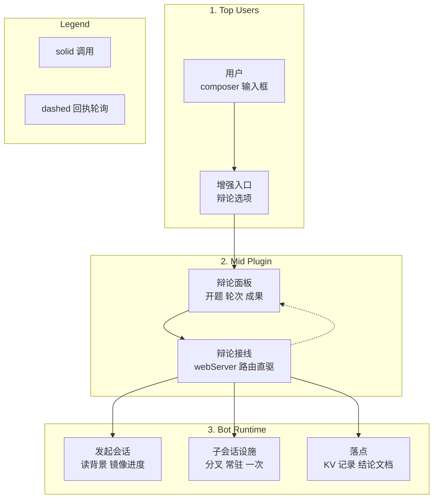
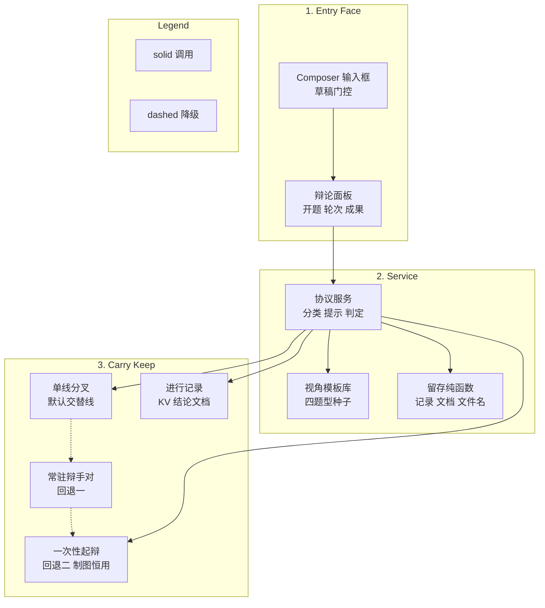
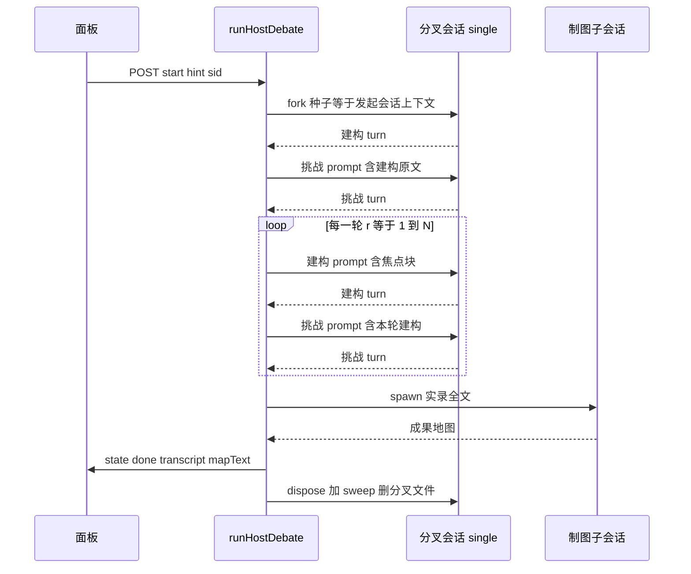

# Debate Architecture Description

> Provenance: `arch reconcile` from `docs/architecture.md` (2026-10-22); split per request
> into debate / cross-tasks pair. Scope here is debate only; cross-tasks lives in
> `docs/architecture-cross-tasks.md`; total view stays in `docs/architecture.md`.
> Zero-invention: every statement traces to `GLOSSARY.md`, `docs/adr/0001~0024`,
> or the code in `src/debate/`, `src/host/`, `src/index.ts` (deliberation part),
> `src/client` (debate half) and `src/version.ts`.
> Naming: debate code lives in `src/debate/` (`debate.ts`/`lenses.ts`/`persist.ts`),
> host internals in `src/host/` (`cage.ts`/`resident.ts`/`types.ts`), wiring in `src/index.ts`.

## 1. Identification and Scope

- **System Name**: dsh-session-enhance / debate subsystem (DSH native plugin `elec-session-enhance`, debate half).
- **Purpose**: 为开放性论证题跑建构 / 挑战 / 制图三角色，产出一套固定五件套成果地图
  （论证表 / 依据表 / 分歧地图 / 缺口清单 + 决策摘要），而非单一结论句
  （GLOSSARY deliberation_map, ADR-0001/0002）。
- **Scope**: `src/debate/` 三纯模块 + `src/host/` 内聚两件 + `src/index.ts` 内 deliberation 接线
  （建单 / 直驱 / 留存 / 路由表）+ `src/client` 辩论半区（Dialog / InputEntry / 纯分段函数）
  + 共用的 `src/version.ts`。跨仓任务不在本文档内，见 `docs/architecture-cross-tasks.md`。
  部署与发包在圈外（见 §4.5）。
- **One seam**: 纯逻辑（`src/debate/`，无 IO，可单测）与载体接线（`src/index.ts` + `src/host/`，
  唯一 tsdown entry 约束）分离。host 直连 `src/debate/*` 与 `src/host/*`（同进程直引，
  无 facade；TOML `exposed = []`，见 `src/debate/module.toml`、`src/host/module.toml`）。

## 2. Stakeholders and Concerns

- **提问者（最终用户）**: 只点一下就开辩论，不填表单；过程可读；最终拿地图自己做判断。
  - **Concerns**: 入口无缝（ADR-0008），过程可读（QAS-1），产物忠实（ADR-0001/0002）。
- **插件维护者**: 改判定逻辑不回归；host 注册失败可观测；重启不丢可诊断信息。
  - **Concerns**: 协议纯函数可单测（spec 缝一），路由契约可查（`/api/debug*`，ADR-0010），
    架构漂移被门拦住（DEBATE-01 / HOST-01 / HOST-02 / CAGE-01 / WIRE-01 / SYM-01）。
- **DSH 部署**: 插件不得扩权（`restrict` 单向收窄），不得改 preset 文件，不得发包到 prod。
  - **Concerns**: 工具笼只收窄（ADR-0022），`standard` preset 全部署。

## 3. Quality Attribute Scenarios (QAS)

- **QAS-1 可读性**: 5 轮辩论（约 13 次子调用，每方 4000+ 字）落进 720px 对话框时，
  提问者 30 秒内能说出"谁让了什么、新增了什么"。驱动分段折叠（摘要默认展开、论证折叠）
  与 `chatDigest` 镜像摘要（只取结论摘要前几行 + 当前答案，全文留 transcript）。
- **QAS-2 可审计性**: 任何"已一致 / 分歧"结论都能回跳到 `[R轮 #seq 角色]` 原文；
  中断原因（超时 / 人停 / 模型拒活）实报，不吞成 `aborted`。每轮判定输入落 `rounds[]`
  （agree / answer / hasNewInfo / 交棒字数 / 引用命中 + `protoVersion`，ADR-0014/0016）。
- **QAS-3 不丢不卡**: 子 agent 调 `ask_user_question` 或大海捞针时必失败、不无限卡 `round=-1`；
  开题一边挂了另一边内容保留（`open-failed: builder=… challenger=…`）。
  **常驻轮次用进度感知超时**：一次性子 agent 走 6 分钟单步超时（无进度可见）；
  常驻轮次按事件增长判活——4 分钟无新事件判 `stalled`，20 分钟硬顶判 `timeout`
  （有进度也砍）。实测教训：给常驻轮次套 6 分钟硬顶会误杀"读了��个文件、跑多轮工具"的正常开题。
- **QAS-4 满血只读**: 辩手能读文件 / 检索 / 联网查证（31 工具继承链），但写不了文件、
  执行不了 shell、套不了娃（白名单笼：辩手 6 项、制图员 3 项，ADR-0022）。
- **QAS-5 接管可见**: 辩论期间发起会话空闲可说话（host 后台直驱，不占 turn）；
  忙闲每轮采样可见、一键双停停两边、打断点在实录可指（ADR-0023）。
- **QAS-6 单线零污染**: 默认单线分叉跑在 fork 子会话里（种子继承发起会话上下文，
  主会话只收转述 + 摘要）；互盲拿掉后挑战者逐条引用建构原文；辩论结束分叉扫掉，
  只留结论文档（ADR-0024）。

## 4. Viewpoints and Views

### 4.1 Context View

- **Purpose**: 辩论半区在 DSH 里占什么位置：一个 host 接线 + 一组 HTTP 路由 + 一个面板，
  不碰会话主循环。黑盒只讲边界。
- **Model/Diagram**:

- **Elements**: 黑盒外只有三样：发起会话（读背景 / 写镜像）、子会话设施
  （`ctx.subagents` spawn、`ctx.agents` 建分叉 / 常驻）、浏览器（2s 轮询 `state`）。
  面板只经 `POST /dsh-session-enhance/api/*` 与 host 说话，不直调 agent。

### 4.2 Logical Decomposition View

- **Purpose**: 辩论半区的职责分层：入口 / 交互 / 服务 / 载体 / 留存。图里只讲职责，
  文件名索引见 Elements。
- **Model/Diagram**:

- **Elements**:
  - `src/debate/debate.ts`（协议层，与载体无关）：`classifyQuestion`（关键词启发式定
    `selection` / `review` / `tradeoff` / `causal`）、`extractSessionContext`（4000 字截断进辩手，
    不进制图）、三段式 prompt（`buildBuilderPrompt` / `buildBuilderRoundPrompt` /
    `buildChallengerPrompt` / `buildSynthesizerPrompt`，v4 起带 `focus` 焦点块与篇幅预算，
    制图要求先出决策摘要段）、判定（`parseAgree` / `parseAnswer` / `detectNewInfo` /
    `isConverged` 停机协议；`parsePendingItems` / `normalizePending` / `pendingStalled` /
    `formatPendingFocus` v4 未决清单焦点账本；`settledDefsOf` 已接受判据锁存 /
    `settledItemsOf` 已决事项第三本账 / `isTopicLoop` 议题循环 / `isOneSidedAccept` 单方接受 /
    `convergedAtCap` 压线修饰位；`changesOf` / `sectionText` 分段取值；
    `extractDecisionSummary` / `stripDecisionSummary` / `buildFallbackSummary` v4 收尾陈述；
    `isSaturated` / `normalizeAnswer` / `containsBannedPhrase`；
    `STOP_PROTOCOL_VERSION` B5 解析版本位当前 7；
    `auditQuotes` / `QUOTE_FRAG_LEN` / `QUOTE_HIT_ALERT` B6 片段级引用审计；
    `ROUND_DETAIL_MAX_CHARS` / `PENDING_MAX_ITEMS` v4 预算；
    `renderTranscriptForSynthesizer` 制图输入清洗去 host 协议行）。
  - `src/debate/lenses.ts`（视角模板库，ADR-0003）：四类题型种子模板
    （`LENS_TEMPLATES` + `defaultLensIds` + `findLens`）；模板只定维度名 + 挑战 checklist +
    证据期望，不写死话术。
  - `src/debate/persist.ts`（留存纯函数，无 IO）：`toRecord`（显式白名单：实时流 /
    镜像开关 / flush 等过程态不落盘）/ `fromRecord`（宽容反序列化：关键字段缺失或版本超前
    则跳过该条，次要字段缺就补默认值）+ `markInterrupted`（把上次记 `running` 的局标成已中断）
    + `slugify` / `reportRelPath`（文件名净化：Windows 非法字符、首尾点 / 连字符、按码点截断
    12 字、中文保留、去语气词、清承接语外壳）+ `renderReport`（结论文档排布：决策摘要 →
    成果地图 → 每轮判定表 → 折叠全文；表格转义 `|`、正文中和 `details` 关闭标签）+
    `STORAGE_UNIT` / `STORAGE_TABLE`（`dsh_session_enhance` / `sessions`，连字符禁用）。
    IO 全在 `src/index.ts`（ADR-0019）。
  - `src/host/cage.ts`（工具笼，S27 摘出，index 只重导出）：
    `DEBATER_TOOL_ALLOW` 6 项 + `SYNTH_TOOL_ALLOW` 3 项 + `toolAllowFor` /
    `resolveToolAllow` / `visibleNamesOf` / `cageLabel` / `scopedToolGuard` /
    `askSubagent` + `turnVerdict` / `STEP_STALL_MS` / `STEP_HARD_CAP_MS` / `PROGRESS_POLL_MS`。
  - `src/host/resident.ts`（常驻辩手对，回退一，S27 摘出）：`createResidentPair`
    （`agents.create` 建双常驻会话 + preset 继承 + `subagent:delegation` 上下文 +
    白名单笼挂载 + 交集核对 + scope-local guard）/ `driveResidentTurn`
    （`followup` 投交棒结论 → 进度感知等 `whenIdle` → 读自有事件后缀 → 校验终止原因 →
    取交棒结论；provider `error` 有界重投 3 次）+ `readResidentEvents` /
    `extractHandoffConclusion` / `epochStopReason` / `epochStopDetail` /
    `heartbeatOf` / `isRetriableTurnError`。
  - `src/host/types.ts`（共享面）：`ParentAgent` / `AgentsLike` / `ResidentAgent` /
    `ResidentPair` / `TextContentBlock` / `AgentPresetsLike` 等 host 与 index 间结构面。
  - `src/index.ts` deliberation 接线（单 tsdown entry 约束，路由表在 `apply()` 逐条注册）：
    `createSingleThread`（fork 发起会话：seed = 当前上下文 + `isSeeded=true` + 模型锁定发起会话
    当前模型）+ `stepOpenSingle` / `stepRoundSingle`（建构先写、挑战再写，串行，无互盲）+
    `sweepSingleThread`（文档落盘后删分叉文件，只留结论文档，失败记 `sweepError` 留痕）；
    `stepOpenResident` / `stepRoundResident`（开题互盲、交锋串行）；
    一次性回退 `askSubagent`（spawn + 工具笼 + 6min 单步超时 + 实报）与
    `stepOpen` / `stepRound` / `stepSynthesize`；`mode` 三态 + `residentError` 记录整条回退链
    （`single:…; resident:…`）；共用 `runHostDebate`（后台直驱 open → round×N → synthesize +
    停机三条件）、`createFullParent`（webhook 样板挂 preset）、`mirror`
    （`user/message` + `surfaceOp:append`）、`focusBlockOf` / `chatDigest` / `finalStatement`、
    `normalizeConfig` / `resolveAuto` / `recordRoundAndJudge`、`interruptMarkOf` /
    `interruptPlanOf` / `parentBusyOf`、KV `persist` / `schedulePersist` / `loadPersisted` /
    `writeReport`。
  - `src/version.ts`（共享）：`BUILD_VERSION`（构建期内联，host / client 各一份）+
    `assessVersions`（内联版本 / 磁盘 manifest / bundle mtime 与进程启动时刻三方对账）+
    `isClientStale`。host 侧 `/api/version` 出事实，面板徽标显示正在跑的版本并在磁盘更新时
    要求重启宿主（ADR-0018）。
  - `src/client` 辩论半区：DebateDialog（2s 轮询 + 分段折叠 `TurnCard`）、`InputEntry`
    （草稿门控）、`useSessions.current` 透传；停机审计块 + 镜像状态行；
    `sections.ts` 纯分段函数（`splitSections` 从 index.tsx 抽出，可单测不拖 React / CSS）；
    `labels.ts`（`roleName` / `roundLabel` / `roundSummary` / `stopKey` 人话标签）；
    `dialogLayout.ts`（尺寸钳制 + 高度持久化）；`session.ts`（`resolveSessionId`）。
    实况只在辩论框内看（2s 轮询 `TurnCard` / `StreamCard`）。

### 4.3 Module Documentation Map

| Module | Docs bucket | Reason | Module doc paths |
| ------ | ----------- | ------ | ---------------- |
| `src/debate` | own pair | 辩论纯协议独立演进（STOP 协议 v1~v7、焦点账本、审计），有独立 vitest 镜像与红线 | `docs/architecture-debate.md`, `docs/action-plan.md` |
| `src/host` | top-level only | host 内聚件（cage / resident），随 debate 接线同发布同测试 | - |
| `src/client` | top-level only | 双面板同 overlay，随 host 同构建同发布（辩论半区见本文档 §4.2，任务半区见兄弟文档） | - |
| `src` | top-level only | host 接线：路由注册 / 辩论循环（单 tsdown entry，同文件逐条注册） | - |

- **Coverage note**: `arch` TOML 覆盖是全量的（`src` + 嵌套 `src/client`、`src/debate`、
  `src/cross_tasks`、`src/host`）；测试单列 `tests/`（§7 行为门 + 治理门）。

### 4.4 Runtime View

- **Purpose**: 一局的命：建单即后台直驱，open → round×N → synthesize，全串行；
  载体三档（单线默认 / 常驻回退一 / 一次性回退二），停机三条件 + 修饰位。
- **Model/Diagram（主路径：单线分叉）**:

- **Elements（主流程）**:
  1. `POST start` 建单（`hint` + `sid` + `cwd` → `targetCwd`；`targetCwd` fail fast；
     用户轮数钳 1~20 并留痕 `config.note`；`session.flush` 挂 `schedulePersist`）。
  2. parent 三段式：`sid` 直取 → 兜底活体 → `createFullParent` 自建满血（挂默认 preset）；
     自建 parent 对话区不可见（`mirrorToChat=false`），真实会话才镜像。
  3. 载体选择：先 `createSingleThread`（fork，种子前缀 + end-seed，开尾 closers，
     分叉血统 + 种子透传 + 模型锁定）；失败记 `residentError` 走常驻双会话
    （开题互盲）；再失败走 one-shot（失败链留痕 `single:…; resident:…`）。
  4. 交锋：开题 + N 轮串行（同一分叉两段 turn 天然有序，无互盲；常驻路径交锋串行保证看到最新；
     每方写完即 `mirror` 进对话区 + `progress` + `streaming` 供面板 2s 轮询）。
     每轮 `recordRoundAndJudge` 落 `rounds[]`（agree / answer / hasNewInfo / pending /
     引用命中 / `protoVersion`）。
  5. 停机判定（每轮后，ADR-0014 + ADR-0017 + ADR-0020）：
     共识收敛（双方显式 agree 且归一化答案一致）/ 覆盖饱和（整轮无新增只看本轮变化段，
     或未决清单连续两轮逐条相同，或清单在变但 4 轮清不空且答案面不动即议题循环）/
     跑满（`maxRounds`，单方接受则结论可用；压线一致标 `convergedAtCap` 并给加轮复验建议）/
     手动（跳制图）。超时 / 中止走 `AbortController` 链（外层 stop → 内层 timeout）。
  6. 制图：`stepSynthesize` 起 one-shot 只读实录（经 `renderTranscriptForSynthesizer` 去协议行），
     输出成果地图 + 决策摘要（制图漏写用 `buildFallbackSummary` 按题型兜底；题型结论形状见
     `answerShapeOf`，`answer=` 同步收窄 `answerSpecOf`）。
  7. 收尾：`writeReport` 写 `<工作区>/docs/session-enhance/日期-slug-id尾.md`
    （决策摘要 → 成果地图 → 每轮判定表 → 折叠全文）；`mirror` 报路径；
     `persist` 写 KV（显式白名单）；单线 `sweepSingleThread` 删分叉文件（`sweepError` /
     `sweptSessions` 留痕）；恢复的局只读（`markInterrupted` 把半途 `running` 标已中断）。
- **接管（只做停两边，不做续跑，ADR-0023）**：`/api/stop` abort 后台 + 记 `interruptedAt`
 （transcript 断点，面板画线）；`/api/interrupt` 先 `parent.cancel keepInbox` 留住用户刚说的话，
  再 abort 后台；`parentBusy` 每轮边界采样 `parent.status`，面板显示忙闲。

### 4.5 Deployment View

- **Purpose**: 单包双 bundle，dev 联调用 3090；辩论与任务同一包发布，无独立发版节拍。
- **Elements**: `lib/index.js`（host：deliberation 接线）+ `lib/client.js`（bundle：辩论 Dialog，
  经 `dsh.client` 声明）；`cordis.patch.yml` 插入组合；`dsh.plugin.json` 声明零模型工具
  （人工操作插件，`contributes.tools` 为空）与三槽位（overlay / input.right + 设置节）。
  dev 用 `dsh --profile dev --port 3090 --no-open`，client 硬刷（Ctrl+Shift+R）。

### 4.6 Security View

- **Purpose**: 插件只读不写：辩手满血读证据，但写盘 / 执行 / 套娃三条路焊死。
- **Elements**: 工具笼白名单（ADR-0022：辩手 6 项、制图员 3 项，fail-closed；启动交集核对
  失效剔除、空集显式失败；scope-local 走执行期 `scopedToolGuard`；`tools.restrict` 单向收窄）；
  自建 parent 挂默认 preset（ADR-0012）；原生发送键只许碰 `setDraft`（建单后清空草稿），
  `submit` 及其他键面板代码禁触。

## 5. Architecture Decisions

- [ADR-0001](adr/0001-map-not-verdict.md): 产物是地图而非结论句。
- [ADR-0002](adr/0002-three-roles.md): 建构 / 挑战 / 制图三角色分离，裁判默认关。
- [ADR-0003](adr/0003-hybrid-lens.md): 视角模板保下限、动态拔上限、人审保方向。
- [ADR-0004](adr/0004-saturation-stop.md): 停在覆盖饱和而非共识收敛（排他性表述已被 ADR-0014 修正）。
- [ADR-0005](adr/0005-claim-layering.md): 断言先分事实 / 推理 / 价值三层。
- [ADR-0006](adr/0006-synthesizer-reuse.md): 制图员复用辩手模型时新会话即算独立。
- [ADR-0007](adr/0007-context-pack.md): 背景包只进辩手不进制图员。
- [ADR-0008](adr/0008-auto-resolve.md): 入口只留三模型，问题与背景全自动。
- [ADR-0009](adr/0009-stepwise-tools.md): 分步工具将会话直播（已被 host 直驱继承）。
- [ADR-0010](adr/0010-tool-registration.md): 工具注册三硬伤与 `/api/debug` 可观测。
- [ADR-0011](adr/0011-host-driven.md): host 直驱��点开始就自动跑。
- [ADR-0012](adr/0012-full-parent.md): 自建 parent 挂默认 preset，子 agent 满血的优雅通道。
- [ADR-0013](adr/0013-resident-debater.md): 常驻辩手 + 交棒结论，替代一次性起辩。
- [ADR-0014](adr/0014-stop-conditions.md): 停机三条件（共识 / 饱和 / 跑满）+ 判定输入落盘。
- [ADR-0015](adr/0015-handoff-slimming.md): 交棒载荷瘦身——跨轮传摘要（-87%），同轮传全文。
- [ADR-0016](adr/0016-audit-protocol.md): 停机信号协议版本化（B5）+ 片段级引用审计（B6）。
- [ADR-0017](adr/0017-focus-ledger-and-closing-statement.md): 协议 v4——未决清单焦点账本 +
  新增判定只看本轮变化段 + 篇幅预算 + 对话区镜像摘要 + 收尾陈述。
- [ADR-0018](adr/0018-version-truth.md): 版本真值——构建期内联 + 三方对账。
- [ADR-0019](adr/0019-conclusion-persistence.md): 结论落盘——整局记录进 KV，结论文档进工作区。
- [ADR-0020](adr/0020-cap-convergence.md): 压线共识——上限处一致是 convergence 修饰位。
- [ADR-0021](adr/0021-optional-audit-versioning.md): 可选审计字段不 bump 记录版本。
- [ADR-0022](adr/0022-tool-cage-allowlist.md): 工具笼改白名单（辩手 6 项、制图员 3 项）。
- [ADR-0023](adr/0023-session-takeover-b.md): 会话接管 B 方案——忙快照 + 一键双停 + 打断可映射。
- [ADR-0024](adr/0024-single-thread-fork.md): 单线分叉——单模型双角色交替线默认驱动。

## 6. Constraints and Risks

- **Technical Constraints**: `tools.restrict` 单向收窄——插件能禁不能加；
  allow / deny 只动全局层（scope-local 名列了就抛 unknown，实测）；
  `subagent` 走执行期 guard；`conversation.input.right` 空 props——sid 必须走 overlay 的
  `useSessions.current`；单 tsdown entry 约束 host 接线同文件。
- **Business Constraints**: 不改部署的 `standard` preset 文件；不发布 prod（3080）与 npm。
- **Identified Risks**:
  - 常驻辩手 context 膨胀 → 跨轮交棒瘦身（`slimHandoff`，实测 -87%）+ `builderRelayChars` 可观测；
    同轮仍传全文保引用能力。
  - 饱和启发式召回偏低 → 已加否定关与显式无新增声明；10-01 实测更严重的是假阳性
    （整篇找信号词 10/10 误判有新料）→ 只看本轮变化段 + 焦点停滞结构化判据。
  - 模型不守约输出 `待决清单=` 行 → 三态解析（`null` 未提供 / `[]` 清空 / 有内容）保证退化方向是
    多辩几轮而非误停；`rounds[].pendingItems` 落盘可事后核对守约率。
  - `startContinuable` 要 `sessionPersistence` + `sessionQuery` → 首选 `agents.create` +
    `followup` + `whenIdle` 直驱，不依赖 continuable 管理器。
  - provider 抖动（偶发 `Internal error`）→ 同会话内对 `error` 有界重投 3 次
   （`isRetriableTurnError`；超时 / 卡死 / 空输出 / 拒绝不重投）。
  - 固定单步超时误杀正常长轮次 → 常驻轮次改进度感知（4 分钟无事件判 stalled / 20 分钟硬顶），
    一次性路径仍固定 6 分钟。
  - 内存会话表重启即清 → KV 持久化已落地（ADR-0019）；恢复的局只读不续跑。

## 7. Test Architecture

- **Vocabulary**: unit test 管一个 ticket，integration test 管一个 spec，
  system test 管两个以上 spec / 整 effort。常驻辩手 effort 的 system test 跑真 1 轮辩论端到端
  （单线分叉 + 制图，断言 transcript 结构与交替链不断）。
- **Tools**: vitest（`tests/vitest/`：`debate.test.ts` 协议 + 回合推进 + 单线分叉 + 笼子交集 +
  打断计划；`persist.test.ts` 落盘白名单 + 反序列化 + 文件名 + markdown；`version.test.ts`；
  `session.test.ts`；`dialogLayout.test.ts`；`labels.test.ts`）；
  pytest（`tests/governance/` vendored 三件套 + `tests/src/debate/`、`tests/src/host/`、
  `tests/src/` 真红线绑定）；`arch_engine.py check`（TOML / 孤儿 / 幻影 / 漂移门）；
  沙箱内 vitest 起不来用 `scripts/test-sandbox.mjs` 编译执行同一套文件。
- **Directory layout**: 单一 `tests/`：`tests/vitest/` 行为门；`tests/governance/` 只读架构门；
  `tests/<module>/`（`src` / `src/debate` / `src/host` / `src/client`）模块真红线绑定；
  `docs/test_index.md` 两扇门总目录；`.tmp/` 沙箱替代校验脚本与真跑 state（gitignored）。
- **Layer-scope overrides**: 本 effort 单 spec 跨 host + client 双 bundle，其 integration gate 按
  system-grade 跑（真起子 agent 读文件），已在 `docs/action-plan.md` 注记，不静默。
- **Invariants (TOML)**:
  - DEBATE-01（`src/debate/module.toml`）：协议 / 视角 / 留存导出面 + vitest 镜像不丢。
  - HOST-01 / HOST-02（`src/host/module.toml`）：cage / resident 符号不出走回 `index.ts`。
  - CAGE-01 / WIRE-01 / SYM-01（`src/module.toml`）：辩手笼 6+3 关闭、路由面不漂移、
    `debate/` 与 `cross_tasks/` 平级对称。
