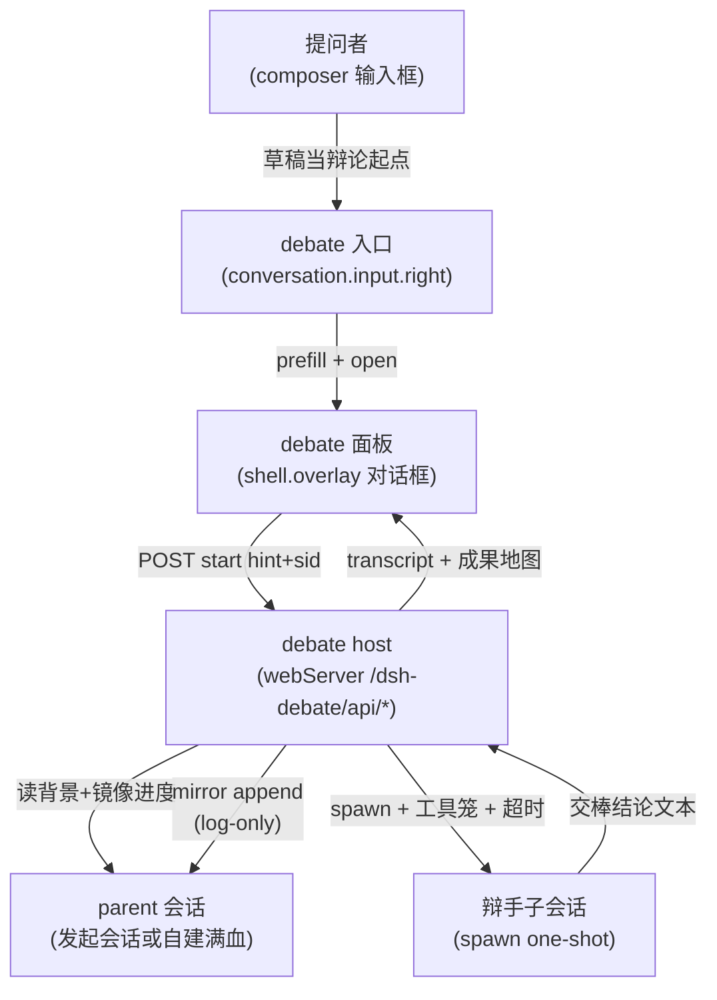
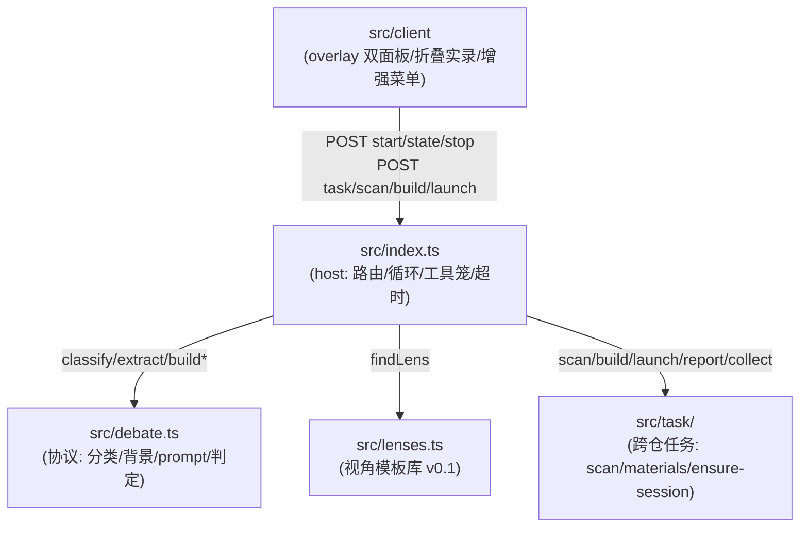
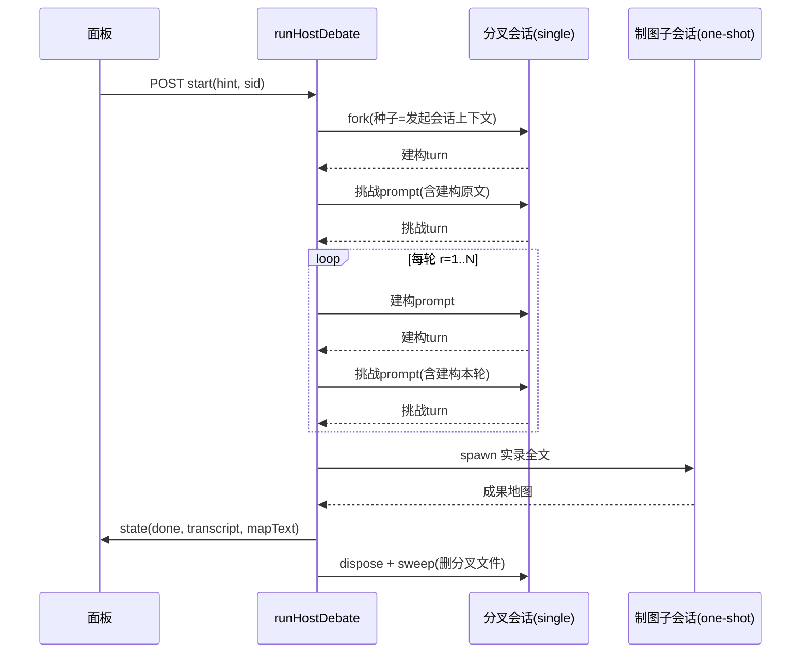

# dsh-debate Architecture Description

> Provenance: `arch` retrofit on a brownfield DSH native plugin (2026-09-30).
> Zero-invention: every statement traces to `CONTEXT.md`, `docs/adr/0001~0012`, or the code in `src/`.

## 1. Identification and Scope

- **System Name**: dsh-debate (doubleelec native DSH plugin `elec-debate`).
- **Purpose**: 为开放性论证题跑建构 / 挑战 / 制图三角色，产出一套固定五件套成果地图，而非单一结论句。
- **Scope**: `src/` 下的 host 半区（webServer 路由 + debate/task 工具 + 辩论循环与跨仓任务接线）与浏览器 bundle（overlay 对话框 + 输入框入口 + 任务面板）。`test/`（vitest 行为门）、`scripts/`、`tests/`（pytest 治理门）在治理树外但分工明确（见 §7）；部署与发包在圈外（见 spec Out of Scope）。
- **Two functions, one seam**: 辩论（`src/index.ts` + `src/debate.ts`）与多仓任务（`src/task/` 三纯模块 + `src/index.ts` 内 task 接线约 480 行）**不分平级目录**——纯逻辑已在同级分开（`debate.ts` vs `task/`），接线层（路由注册/工具注册/控制器）平台强制同文件（tsdown entry 单 `src/index.ts`、路由表在 `apply()` 逐条注册）。硬拆平级目录造 shallow module：删掉它复杂度不消失（deletion test 不过），跨"辩论 vs 任务"没有可变点（two-adapter rule 不过）。减负方向是同模块内抽（`src/task/host.ts`、`src/client/TaskDialog.tsx`），见 ADR-0025 §7。

## 2. Stakeholders and Concerns

- **提问者（最终用户）**: 只想点一下就开辩，不填表单；要看到辩论过程可读、可审计；最终拿地图自己做判断。
  - **Concerns**: 入口无缝（ADR-0008），过程可读，产物忠实（ADR-0001/0002）。
- **插件维护者**: 改判定逻辑不回归，host 注册失败可观测，重启不丢可诊断信息。
  - **Concerns**: 协议纯函数可单测（spec 缝一），路由契约可查（`/api/debug*`），架构漂移被门拦住。
- **DSH 部署**: 插件不得扩权（`restrict` 单向收窄），不得改 preset 文件，不得发包到 prod。
  - **Concerns**: 工具笼只收窄（ADR-0012），`standard` preset 部署所有。

## 3. Quality Attribute Scenarios (QAS)

- **QAS-1 可读性**: 5 轮辩论（约 13 次子调用，每方 4000+ 字）落进 720px 对话框时，提问者 30 秒内能说出“谁让了什么、新增了什么”。驱动分段折叠（摘要默认展开、论证折叠）。
- **QAS-2 可审计性**: 任何“已一致/分歧”结论都能回跳到 `[R轮 #seq 角色]` 原文；中断原因（超时/人停/模型拒活）实报，不吞成 `aborted`。
- **QAS-3 不丢不卡**: 子 agent 调 `ask_user_question` 或大海捞针时必失败、不无限卡 `round=-1`；开题一边挂了另一边的内容保留（`open-failed: builder=… challenger=…`）。**常驻辩手用进度感知超时**：一次性子 agent 走 6 分钟单步超时（无进度可见）；常驻轮次按事件增长判活——4 分钟无新事件判 `stalled`，20 分钟硬顶判 `timeout`（有进度也砍）。实测教训：给常驻轮次套 6 分钟硬顶会误杀"读了两个文件、跑多轮工具"的正常开题。
- **QAS-4 满血只读**: 辩手能读文件/检索/联网查证（31 工具继承链），但写不了文件、执行不了 shell、套不了娃（白名单笼：辩手 6 项、制图员 3 项，ADR-0022）。
- **QAS-5 接管可见**: 辩论期间发起会话空闲可说话（host 后台直驱，不占 turn）；忙闲每轮采样可见、一键双停停两边、打断点在实录可指（ADR-0023）。
- **QAS-6 单线零污染**: 默认单线分叉跑在 fork 子会话里（种子继承上下文，主会话只收转述+摘要）；互盲拿掉后挑战者逐条引用建构原文；辩论结束分叉扫掉，只留结论文档（ADR-0024）。

## 4. Viewpoints and Views

### 4.1 Context View

- **Purpose**: 插件在 DSH 里只占三个槽位 + 一组 HTTP 路由，不碰会话主循环。
- **Model/Diagram**:

- **Elements**: 外部只有三样：发起会话（读背景/写镜像）、子 agent 设施（`ctx.subagents` spawn）、浏览器（轮询 state）。

### 4.2 Logical Decomposition View

- **Purpose**: 单治理模块 `src`，内部按文件分工；client 与 task 是嵌套治理模块。
- **Model/Diagram**:

- **Elements**:
  - `src/index.ts` 宿主侧分三层（`mode` 三态，默认单线）：
    - **单线分叉（默认路径，ADR-0024）**：`createSingleThread`（fork 发起会话：seed=当前上下文 + `isSeeded=true` + 模型锁定发起会话当前模型）+ `stepOpenSingle/stepRoundSingle`（建构先写、挑战再写，串行，无互盲）+ `sweepSingleThread`（文档落盘后删分叉文件，只留结论文档，失败记 `sweepError` 留痕）。
    - **常驻交棒（回退一）**：`createResidentPair`（`agents.create` 建双常驻会话 + preset 继承 + `subagent:delegation` 上下文 + 白名单笼：辩手 6 项、交集核对、scope-local guard）、`stepOpenResident/stepRoundResident`（开题互盲、交锋串行）、`driveResidentTurn`（`followup` 投交棒结论 → 进度感知等到 `whenIdle` → 读自有事件后缀 → 校验终止原因 → 取交棒结论；provider `error` 有界重投）、`readResidentEvents/extractHandoffConclusion/epochStopReason/epochStopDetail/turnVerdict`。
    - **一次性回退（回退二）**：`askSubagent`（spawn + 工具笼 + 6min 单步超时 + 实报）与 `stepOpen/stepRound/stepSynthesize`；`agents` 缺失或建对失败时整场回退，`mode/residentError` 记录整条回退链（`single:…; resident:…`）。
    - **共用**：`runHostDebate`（后台直驱 open→round×N→synthesize + 停机三条件）、`createFullParent`（webhook 样板挂 preset）、`mirror`（`user/message` + `surfaceOp:'append'`）。
  - `src/debate.ts`: `classifyQuestion`（关键词启发式）、`extractSessionContext`（4000 字截断）、`buildBuilderPrompt/buildBuilderRoundPrompt/buildChallengerPrompt/buildSynthesizerPrompt`（三段式：结论摘要/详细论证/本轮变化，v4 起带 `focus` 焦点块与篇幅预算；制图要求先出「决策摘要」段）、`parseAgree/parseAnswer/detectNewInfo/isConverged`（停机协议）、`parsePendingItems/normalizePending/pendingStalled/formatPendingFocus`（v4 未决清单焦点账本）、`changesOf/sectionText`（分段取值）、`extractDecisionSummary/stripDecisionSummary/buildFallbackSummary`（v4 收尾陈述）、`isSaturated/normalizeAnswer/containsBannedPhrase`、`STOP_PROTOCOL_VERSION`（B5 解析版本位，v4）、`auditQuotes/QUOTE_FRAG_LEN/QUOTE_HIT_ALERT`（B6 片段级引用审计）、`ROUND_DETAIL_MAX_CHARS/PENDING_MAX_ITEMS`（v4 预算）。
  - `src/lenses.ts`: 四类题型种子模板（selection/review/tradeoff/causal）。
  - `src/version.ts`: 版本真值——`BUILD_VERSION`（构建期内联，host/client 各一份）+ `assessVersions`（内联版本 / 磁盘 manifest / bundle mtime 与进程启动时刻三方对账）+ `isClientStale`。host 侧 `/dsh-debate/api/version` 出事实，面板徽标显示**正在跑的版本**并在磁盘更新时要求重启宿主（ADR-0018）。
  - `src/persist.ts`: 留存层的纯函数（无 IO，故可单测）——`toRecord`（**显式白名单**：实时流/镜像开关/flush 等过程态不落盘）/`fromRecord`（宽容反序列化：关键字段缺失或版本超前则跳过该条，次要字段缺就补默认值）+ `markInterrupted`（把上次记 `running` 的局标成已中断）+ `slugify`/`reportRelPath`（文件名净化：Windows 非法字符、首尾点/连字符、按码点截断、中文保留）+ `renderReport`（结论文档排布：决策摘要 → 成果地图 → 每轮判定表 → 折叠全文；表格转义 `|`、正文中和 `
`）+ `STORAGE_UNIT/STORAGE_TABLE`。IO 全在 `src/index.ts`（ADR-0019）。
  - `src/client`: 停机审计块 + 镜像状态行（state 早有字段，S3 才接上）；`sections.ts` 纯分段函数（`splitSections` 从 index.tsx 抽出，可单测不拖 React/CSS）。实况只在辩论框内看（2s 轮询 `TurnCard/StreamCard`），独立实况页已删除（生产环境反向代理下基址推导打偏，只会“连接中…”）。
  - `src/client`: `DebateDialog`（2s 轮询 + 分段折叠 `TurnCard`）、`InputEntry`（草稿门控）、`useSessions.current` 透传（修 `input.right` 空 props 的根子）。
  - `src/task/`: 跨仓任务纯模块（ADR-0025）——`scan.ts`（结构探针，`FsDeps` 注入可测）、`materials.ts`（模板填充 + ASCII 门 + 回信汇总）、`ensure-session.ts`（分组会话三道门：`meta.cwd` → workspace 注册 → `attachSession` → `followup` 派活，`EnsureDeps` 注入可测）。host 路由 `/dsh-debate/api/task/*` 7 条 + 模型工具 `task_*` 5 个，走同一套注册（逐条 register，显式整壳 Schema）。
  - `src/client`（任务半区）: `✦ 增强` 菜单（`InputButton` 二选一：辩论/多仓任务，按钮常亮各走各的门）+ `TaskDialog`（scan → build → launch 三步显式按钮，偏好存 localStorage）+ `src/client/task.ts` 纯逻辑（解析/校验/偏好，无 React/CSS，node environment 直测）。原生发送键不可拦截——任务启动必须点面板显式按钮（`inputActions` 全仓只有 `setDraft`）。

### 4.3 Module Documentation Map

| Module | Docs bucket | Reason | Module doc paths |
| ------ | ----------- | ------ | ---------------- |
| `src` | top-level only | 单插件单模块，无独立发包/测试节拍 | - |
| `src/client` | top-level only | 随 host 同构建同发布（tsdown 一次出双 bundle） | - |
| `src/task` | top-level only | TS 纯模块随 host 同构建；治理树沿 `src` submodule 声明（orphan/phantom 门按 `src/client` 同例） | - |

- **Coverage note**: `arch` TOML 覆盖是全量的（`src` + 嵌套 `src/client`、`src/task`）；`test/`（vitest 行为门）、`scripts/`、`tests/`（pytest 治理门）在治理树外但分工明确（见 §7）。

### 4.4 Runtime/Concurrency View

- **Purpose**: 现行单线分叉（`single_thread`，默认；常驻/one-shot 为回退）的时序。
- **Model/Diagram**:

- **Elements**: 开题/交锋全串行（同一会话两段 turn 天然有序，无互盲）；交锋串行（保证看到最新）；制图只读实录。超时/中止走 `AbortController` 链（外层 stop → 内层 timeout）。接管只做"停两边"（`/api/interrupt`：parent.cancel keepInbox + abort 后台），不做续跑（ADR-0023）。回退链：单线失败 → 常驻双会话（开题互盲）→ one-shot；`residentError` 记整条链。

### 4.5 Deployment/Physical View

- **Purpose**: 单包双 bundle，dev 联调用 3090。
- **Elements**: `lib/index.js`（host）+ `lib/client.js`（bundle，经 `dsh.client` 声明）；`cordis.patch.yml` 插入组合；`dsh.plugin.json` 声明 `debate_*` 4 工具 + `task_*` 5 工具（+ 常驻 `debate_start`）与三槽位（header/overlay/input.right + 设置节）。dev 用 `dsh --profile dev --port 3090 --no-open`，client 硬刷（Ctrl+Shift+R）。

## 5. Architecture Decisions

- [ADR-0001](adr/0001-map-not-verdict.md): 产物是地图而非结论句。
- [ADR-0002](adr/0002-three-roles.md): 建构/挑战/制图三角色分离，裁判默认关。
- [ADR-0003](adr/0003-hybrid-lens.md): 视角模板保下限、动态拔上限、人审保方向。
- [ADR-0004](adr/0004-saturation-stop.md): 停在覆盖饱和而非共识收敛（排他性表述已被 ADR-0014 修正）。
- [ADR-0005](adr/0005-claim-layering.md): 断言先分事实/推理/价值三层。
- [ADR-0006](adr/0006-synthesizer-reuse.md): 制图员复用辩手模型时新会话即算独立。
- [ADR-0007](adr/0007-context-pack.md): 背景包只进辩手不进制图员。
- [ADR-0008](adr/0008-auto-resolve.md): 入口只留三模型，问题与背景全自动。
- [ADR-0009](adr/0009-stepwise-tools.md): 分步工具将会话直播（已被 host 直驱继承）。
- [ADR-0010](adr/0010-tool-registration.md): 工具注册三硬伤与 `/api/debug` 可观测。
- [ADR-0011](adr/0011-host-driven.md): host 直驱，点开始就自动跑。
- [ADR-0012](adr/0012-full-parent.md): 自建 parent 挂默认 preset，子 agent 满血的优雅通道。
- [ADR-0013](adr/0013-resident-debater.md): 常驻辩手 + 交棒结论，替代一次性起辩。
- [ADR-0014](adr/0014-stop-conditions.md): 停机三条件（共识/饱和/跑满）+ 判定输入落盘，修正 ADR-0004 的排他表述。
- [ADR-0015](adr/0015-handoff-slimming.md): 交棒载荷瘦身——跨轮传摘要（-87%），同轮传全文。
- [ADR-0016](adr/0016-audit-protocol.md): 停机信号协议版本化（B5）+ 片段级引用审计（B6，下限估计）+ 面板/实况审计展示联调。
- [ADR-0017](adr/0017-focus-ledger-and-closing-statement.md): 协议 v4——未决清单焦点账本 + 新增判定只看「本轮变化」段 + 篇幅预算 + 对话区镜像摘要 + 收尾陈述（决策摘要/兜底）。
- [ADR-0018](adr/0018-version-truth.md): 版本真值——构建期内联 + 三方对账；徽标显示正在跑的版本，取不到时显示 `v?` 而非冒充新版本。（同日更正：本 profile 关的是**模块监听**，不是 DSH 没有热重载。）
- [ADR-0019](adr/0019-conclusion-persistence.md): 结论落盘——整局记录进 KV 单元 `dsh_debate`（per-record）、结论文档进 `<工作区>/docs/debates/`；恢复的局只读且把半途的标成已中断；两条失败原因分开可见。
- [ADR-0020](adr/0020-cap-convergence.md): 压线共识——上限处一致是 convergence 的修饰位（`convergedAtCap`），只改说法不改停机；镜像/兜底收尾/面板审计三处标"压线"并给加轮复验建议。
- [ADR-0021](adr/0021-optional-audit-versioning.md): 可选审计字段不 bump 记录版本——只有不兼容变更才 +1；`pointerAudit` 为判例（`?` 可选 + 缺即 unknown + 只审计不 gate）。
- [ADR-0022](adr/0022-tool-cage-allowlist.md): 工具笼改白名单——deny 黑名单 fail-open（新工具默认放行），allow 白名单 fail-closed；辩手 6 项、制图员 3 项；启动交集核对（失效剔除、空集失败）、scope-local 走执行期 guard、生效笼型进已启动行 + 落盘（可选审计字段）。
- [ADR-0023](adr/0023-session-takeover-plan-b.md): 会话接管 B 方案——忙快照 + 一键双停 + 打断可映射（旧局落盘/新局可见/面板画线）。
- [ADR-0024](adr/0024-single-thread-fork.md): 单线分叉——单模型双角色交替线（互盲拿掉：挑战者能看到建构原文逐条反驳；载体用分叉保主会话零污染；种子照抄原生 fork；防呆 `isRouteIneffective` 豁免单线）。
- [ADR-0025](adr/0025-task-merge.md): 增强入口与跨仓任务并入——输入框按钮改"✦ 增强"弹菜单（辩论/多仓任务），原生发送键不借用（`inputActions` 全仓只有 `setDraft`）；task 三纯模块并入 `src/task/`，路由挂 `/dsh-debate/api/task/*` 7 条，模型工具 `task_*` 5 个，launch 三道门 + issued 门照抄 launcher。

## 6. Constraints and Risks

- **Technical Constraints**: `tools.restrict` 单向收窄——插件能禁不能加；allow/deny 只动全局层（scope-local 名列了就抛 unknown，实测）：`subagent` 走执行期 guard；`conversation.input.right` 空 props——sid 必须走 overlay 的 `useSessions.current`。
- **Business Constraints**: 不改部署的 `standard` preset 文件；不发布 prod（3080）与 npm。
- **Identified Risks**:
  - 常驻辩手 context 膨胀（第 5 轮 prompt 爆掉）→ 跨轮交棒瘦身（`slimHandoff`，实测 -87%）+ `builderRelayChars` 可观测（ADR-0015）；同轮仍传全文保引用能力。
  - 饱和启发式召回偏低（关键词 + 相似度）→ 已加否定关（"没有新增缺口"不再误判为新增）与"显式无新增声明"快判。**10-01 实测发现更严重的是假阳性**：`detectNewInfo` 在整篇 6000~8000 字里找信号词，10/10 轮全判"有新料"，饱和停机形同死代码。修法见 ADR-0017：只看「本轮变化」段 + 未决清单焦点停滞（结构化判据，不再靠满篇找词）。
  - 模型不守约输出 `待决清单=` 行时焦点账本失效 → 三态解析（`null` 未提供 / `[]` 清空 / 有内容）保证退化方向是"多辩几轮"而非"误停"；`rounds[].pendingItems` 落盘可事后核对守约率。
  - `startContinuable` 要 `sessionPersistence` + `sessionQuery`，插件 host 未必挂载 → 首选 `agents.create` + `followup` + `whenIdle` 直驱（见 ADR-0013），不依赖 continuable 管理器。
  - provider 会抖：实测 muse 路由抛 `Internal error: name '_muse_session_id' is not defined`（偶发），一次抖动就废掉整场 → 同会话内对 `error` 有界重投 3 次；重投判据 `isRetriableTurnError`（超时/卡死/空输出/拒绝不重投）。
  - 固定单步超时会误杀正常长轮次（实测 6 分钟砍掉"读两个文件 + 多轮工具"的开题）→ 常驻轮次改进度感知（4 分钟无事件判 stalled / 20 分钟硬顶），一次性路径仍用固定 6 分钟（无进度可见）。
  - 内存会话表重启即清（`unknown-id`）→ 重启后面板局需重开；后续可持久化（out of scope）。

## 7. Test Architecture

- **Vocabulary**: unit test 管一个 ticket，integration test 管一个 spec，常驻辩手 effort 的 system test 跑"真 1 轮辩论端到端"（单线分叉 + 制图，断言 transcript 结构与交替链不断）。
- **Tools**: vitest（`test/`，192 用例：协议纯函数 + 回合推进 + 单线分叉 + 落盘往返 + 面板分段，2026-10-20 本地 192/192）；pytest（`tests/governance` vendored 三件套 + `tests/src` 镜像）；`arch_engine.py check`（TOML/孤儿/幻影/漂移门）；沙箱内 vitest 起不来（spawn EPERM）时用 `scripts/test-sandbox.mjs` 编译并执行同一份测试文件（垫片遇到未实现的 matcher 抛错而非静默通过）。
- **Directory layout**: `test/` → vitest 真用例（行为门：协议/回合/单线分叉/落盘/面板）；`tests/governance/` → 只读 vendored 门（架构门，动不得：orphan/phantom/kit 完备/meta-index）；`tests/src/` → 模块镜像占位（只满足 kit 完备门"每个模块必须有镜像目录"，真实行为门在 `test/`）；`docs/test_index.md` → 治理套件目录（只登治理门，不登 vitest）；`.tmp/` → 沙箱替代校验脚本与真跑 state（gitignored，可清）。**`test/` 与 `tests/` 不冗余**：行为对错归前者，架构漂移归后者；删任何一个都丢一扇门。pytest 产物（`__pycache__/`、`.pytest_cache/`）是运行期垃圾，不在治理内（见 `.gitignore` 约束）。
- **Layer-scope overrides**: 本 effort 单 spec 跨 host+client 双 bundle，其 integration gate 按 system-grade 跑（真起子 agent 读文件，见笼子验证局），已在 `docs/action-plan.md` Wave 1 注记，不静默。
- **Layer-scope overrides**: 本 effort 单 spec 跨 host+client 双 bundle，其 integration gate 按 system-grade 跑（真起子 agent 读文件，见笼子验证局），已在 `docs/action-plan.md` Wave 1 注记，不静默。
