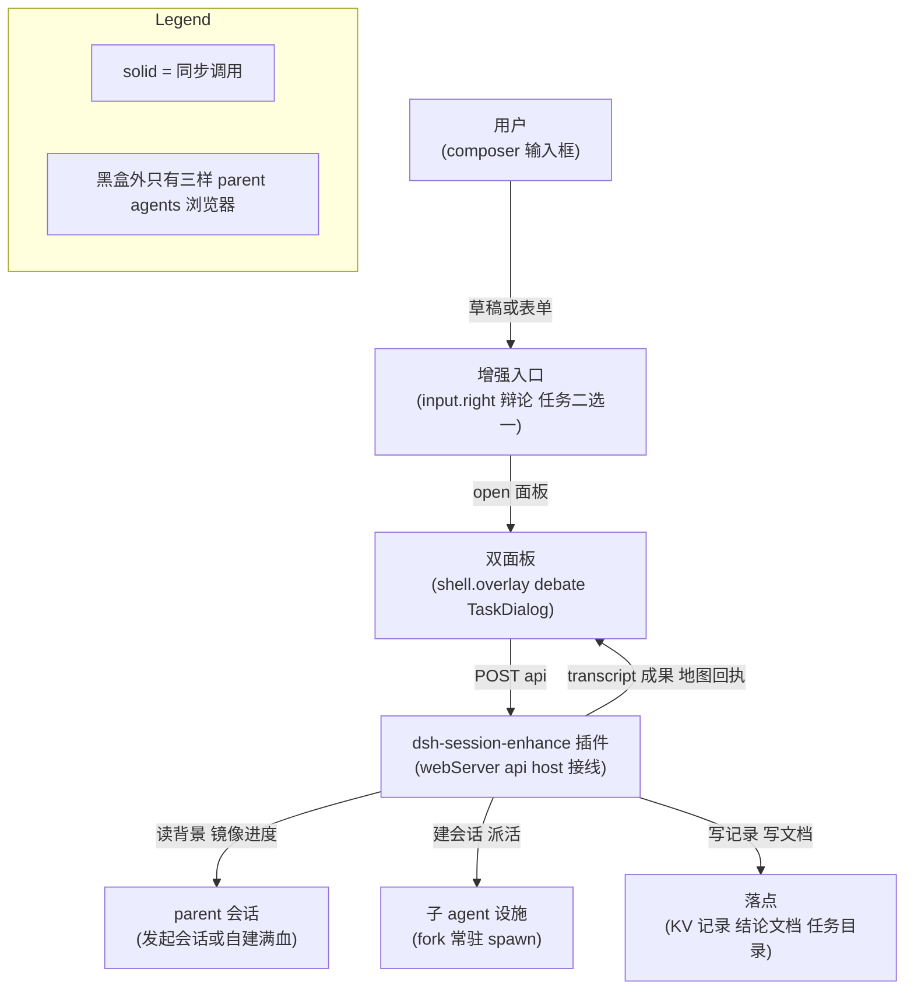
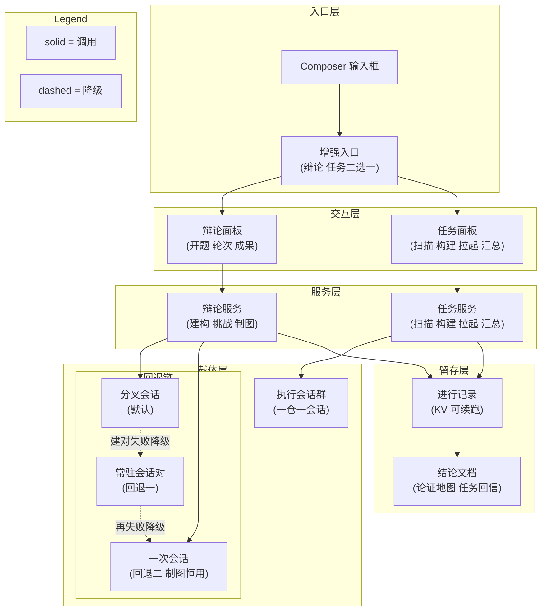
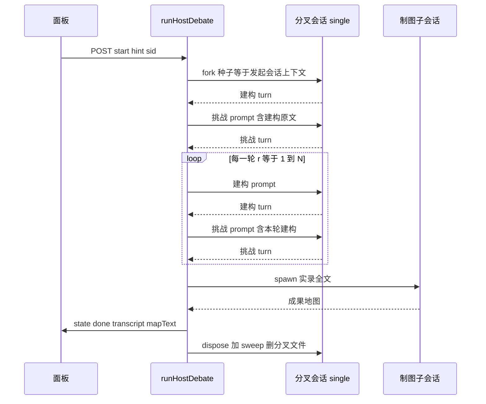
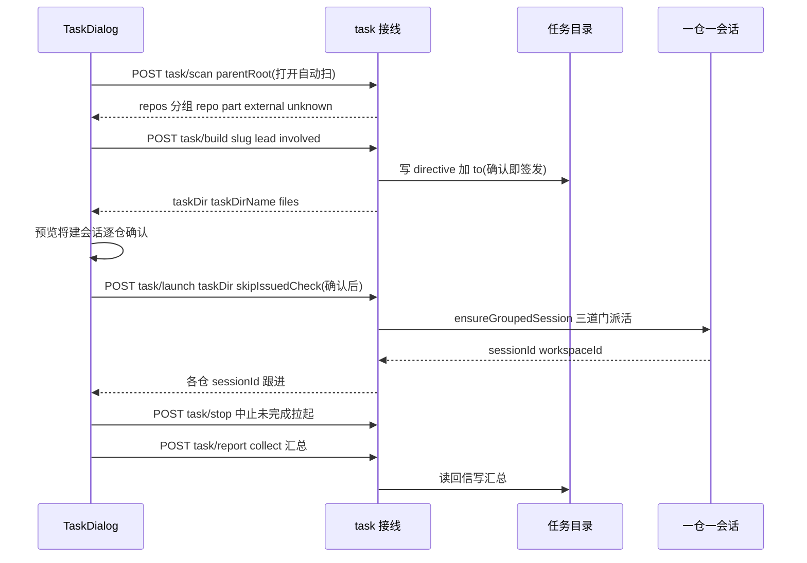

# dsh-session-enhance Architecture Description

> Provenance: `arch` retrofit on a brownfield DSH native plugin (2026-09-30);
> 跨仓任务并入见 ADR-0025（2026-10-20），单线分叉见 ADR-0024；v0.14.0 全量更名 + 去模型工具（人工操作插件，`contributes.tools` 为空）。
> Zero-invention: every statement traces to `GLOSSARY.md`, `docs/adr/0001~0025`, or the code in `src/`.
> Merge record (S20): vitest 行为门 `test/` 与 pytest 治理门 `tests/` 合并为单一 `tests/` 布局
> （`tests/vitest/` 行为 + `tests/governance/` 架构 + `tests/<module>/` 镜像）；`docs/test_index.md`
> 从"只登治理门"扩为"两扇门总目录"。`npm run test:sandbox` 跑合并后同一套文件。
> Merge record (S22 对称)：辩论纯逻辑从 `src/*.ts` 平铺搬入 `src/debate/`（`debate.ts`/`lenses.ts`/`persist.ts`），
> 与 `src/cross_tasks/` 平级对等；`src/version.ts` 留顶层共享（host/client 共用）；host 接线仍在 `src/index.ts`
> （单 tsdown entry，平台约束不变）。红线 SYM-01 + DEBATE-01 落 TOML（v0.14.0 去模型工具：WIRE-01 改守路由面，CAGE-01/SYM-01 续守笼与符号面），`tests/src/debate/` 镜像随行。
> 定位收敛（S21+S24）：辩论 v0.1 设计草稿 `docs/debate-design.md` 已删除（内容冻结在 git 历史）；
> 本文件是全工程唯一架构描述（双功能：辩论 + 跨仓任务）。
> S27 host 内聚：工具笼（`host/cage.ts`）与常驻辩手对（`host/resident.ts`）从 `src/index.ts` 摘出，
> index 只留路由表 + 重导出（单 tsdown entry 约束不变）；tests 直连 `src/host/*`，不再穿 index 缝。

## 1. Identification and Scope

- **System Name**: dsh-session-enhance (doubleelec native DSH plugin `elec-session-enhance`).
- **Functions**: 两个入口、两套 host 接线、一套面板外壳——
  - **辩论**：为开放性论证题跑建构 / 挑战 / 制图三角色，产出一套固定五件套成果地图，而非单一结论句；
  - **跨仓任务**：扫一父目录下多仓结构（scan）→ 建任务材料目录（build，人审改 issued）→ 一仓一会话拉起执行（launch）→ 回信汇总（report/collect），见 ADR-0025。
- **Scope**: `src/` 下的 host 半区（webServer 路由 + 辩论循环与跨仓任务接线，不注册模型工具）与浏览器 bundle（overlay 对话框 + 输入框入口 + 任务面板）。测试单列 `tests/`（§7：vitest 行为门 + pytest 治理门，两扇门一处放）；部署与发包在圈外（见 spec Out of Scope）。
- **Two functions, one seam**: 辩论（`src/debate/` 三纯模块 + `src/index.ts` 内 deliberation 接线）与多仓任务（`src/cross_tasks/` 三纯模块 + `src/index.ts` 内 task 接线约 480 行）是**平级对等目录**（S22 对称：`debate/` vs `cross_tasks/`，各管各的纯逻辑；`src/version.ts` 共享）。接线层（路由注册/工具注册/控制器）平台强制同文件（tsdown entry 单 `src/index.ts`、路由表在 `apply()` 逐条注册）。S27 摘出 host 内聚两件（不碰路由表）：工具笼 → `src/host/cage.ts`（白名单/交集核对/guard/`askSubagent`），常驻辩手对 → `src/host/resident.ts`（建对/交棒/停机判定）；`index.ts` 只留路由表 + 重导出（兼容旧 import 面），tests 直连 `src/host/*`。

## 2. Stakeholders and Concerns

- **提问者（最终用户）**: 只想点一下就开辩论，不填表单；要看到辩论过程可读、可审计；最终拿地图自己做判断。
  - **Concerns**: 入口无缝（ADR-0008），过程可读，产物忠实（ADR-0001/0002）。
- **多仓任务发起人（同一用户，任务视角）**: 一父目录下多仓并行推进，任务材料人审后再拉会话，不拉空模板会话。
  - **Concerns**: 结构先看清（scan 分组可勾），材料先审后发（issued 门），一仓一会话可跟进（launch 回 sessionId），回信可汇总（report/collect）。
- **插件维护者**: 改判定逻辑不回归，host 注册失败可观测，重启不丢可诊断信息。
  - **Concerns**: 协议纯函数可单测（spec 缝一），路由契约可查（`/api/debug*`），架构漂移被门拦住。
- **DSH 部署**: 插件不得扩权（`restrict` 单向收窄），不得改 preset 文件，不得发包到 prod。
  - **Concerns**: 工具笼只收窄（ADR-0012），`standard` preset 部署所有。

## 3. Quality Attribute Scenarios (QAS)

- **QAS-1 可读性**: 5 轮辩论（约 13 次子调用，每方 4000+ 字）落进 720px 对话框时，提问者 30 秒内能说出“谁让了什么、新增了什么”。驱动分段折叠（摘要默认展开、论证折叠）。
- **QAS-2 可审计性**: 任何“已一致/分歧”结论都能回跳到 `[R轮 #seq 角色]` 原文；中断原因（超时/人停/模型拒活）实报，不吞成 `aborted`。
- **QAS-3 不丢不卡**: 子 agent 调 `ask_user_question` 或大海捞针时必失败、不无限卡 `round=-1`；开题一边挂了另一边的内容保留（`open-failed: builder=… challenger=…`）。**常驻辩手用进度感知超时**：一次性子 agent 走 6 分钟单步超时（无进度可见）；常驻轮次按事件增长判活——4 分钟无新事件判 `stalled`，20 分钟硬顶判 `timeout`（有进度也砍）。实测教训：给常驻轮次套 6 分钟硬顶会误杀"读了两个文件、跑多轮工具"的正常开题。
- **QAS-4 满血只读**: 辩手能读文件/检索/联网查证（31 工具继承链），但写不了文件、执行不了 shell、套不了娃（白名单笼：辩手 6 项、制图员 3 项，ADR-0022）。
- **QAS-5 接管可见**: 辩论期间发起会话空闲可说话（host 后台直驱，不占 turn）；忙闲每轮采样可见、一键双停停两边、打断点在实录可指（ADR-0023）。
- **QAS-6 单线零污染**: 默认单线分叉跑在 fork 子会话里（种子继承上下文，主会话只收转述+摘要）；互盲拿掉后挑战者逐条引用建构原文；辩论结束分叉扫掉，只留结论文档（ADR-0024）。
- **QAS-7 任务先审后发**: scan 先看清结构（repo/part/external/unknown 分组）；打开面板自动扫并预填（cwd 默认、repo 全勾、slug 自拟），"重新扫描"只在换目录时手点；build 写材料目录后直接进预览——逐仓列出"仓→cwd→provider/model"，确认才拉起（确认即签发，`skipIssuedCheck` 直发，directive 照常写盘留痕）；stop 能 abort 未完成的拉起（已冒出的会话不回收，人去会话列表跟进）。

## 4. Viewpoints and Views

### 4.1 Context View

- **Purpose**: 插件在 DSH 里只占三个槽位 + 一组 HTTP 路由，不碰会话主循环。黑盒只讲边界：一张总图说清插件长什么样、跟谁打交道；功能区分在系统内部，不在黑盒里分图。
- **Model/Diagram**:

- **Elements**: 黑盒外只有三样：发起会话（读背景/写镜像）、子 agent 设施（`ctx.subagents` spawn、`ctx.agents` 建分叉/常驻）、浏览器（轮询 state）。两条线的走法是内部细节，见 §4.4a（辩论）/ §4.4b（任务）时序。

### 4.2 Logical Decomposition View

- **Purpose**: 职责分层一张图：入口 / 交互 / 服务 / 载体 / 留存五层。图里只讲职责、不带文件名——"哪个职责落在哪个目录"见 §4.3 映射表，文件名索引见 Elements。
- **Model/Diagram**:

- **Elements (debate)**:
  - `src/index.ts` 宿主侧分三层（`mode` 三态，默认单线）+ `src/host/` 内聚两件（S27 摘出，index 重导出兼容旧面）：
    - **工具笼**（`host/cage.ts`）：`DEBATER_TOOL_ALLOW/SYNTH_TOOL_ALLOW` + `toolAllowFor/resolveToolAllow/visibleNamesOf/cageLabel/scopedToolGuard` + `askSubagent` + `turnVerdict/STEP_STALL_MS/STEP_HARD_CAP_MS/PROGRESS_POLL_MS`。
    - **常驻辩手对**（`host/resident.ts`）：`createResidentPair`（`agents.create` 建双常驻会话 + preset 继承 + `subagent:delegation` 上下文 + 白名单笼：辩手 6 项、交集核对、scope-local guard）、`driveResidentTurn`（`followup` 投交棒结论 → 进度感知等到 `whenIdle` → 读自有事件后缀 → 校验终止原因 → 取交棒结论；provider `error` 有界重投）+ `readResidentEvents/extractHandoffConclusion/epochStopReason/epochStopDetail/heartbeatOf/isRetriableTurnError`。
    - **单线分叉（默认路径，ADR-0024）**：`createSingleThread`（fork 发起会话：seed=当前上下文 + `isSeeded=true` + 模型锁定发起会话当前模型）+ `stepOpenSingle/stepRoundSingle`（建构先写、挑战再写，串行，无互盲）+ `sweepSingleThread`（文档落盘后删分叉文件，只留结论文档，失败记 `sweepError` 留痕）。
    - **常驻交棒（回退一）**：`createResidentPair`（`agents.create` 建双常驻会话 + preset 继承 + `subagent:delegation` 上下文 + 白名单笼：辩手 6 项、交集核对、scope-local guard）、`stepOpenResident/stepRoundResident`（开题互盲、交锋串行）、`driveResidentTurn`（`followup` 投交棒结论 → 进度感知等到 `whenIdle` → 读自有事件后缀 → 校验终止原因 → 取交棒结论；provider `error` 有界重投）、`readResidentEvents/extractHandoffConclusion/epochStopReason/epochStopDetail/turnVerdict`。
    - **一次性回退（回退二）**：`askSubagent`（spawn + 工具笼 + 6min 单步超时 + 实报）与 `stepOpen/stepRound/stepSynthesize`；`agents` 缺失或建对失败时整场回退，`mode/residentError` 记录整条回退链（`single:…; resident:…`）。
    - **共用**：`runHostDebate`（后台直驱 open→round×N→synthesize + 停机三条件）、`createFullParent`（webhook 样板挂 preset）、`mirror`（`user/message` + `surfaceOp:'append'`）。
  - `src/debate/`（与 `src/cross_tasks/` 平级对等，S22 对称）——
    - `debate.ts`: `classifyQuestion`（关键词启发式）、`extractSessionContext`（4000 字截断）、`buildBuilderPrompt/buildBuilderRoundPrompt/buildChallengerPrompt/buildSynthesizerPrompt`（三段式：结论摘要/详细论证/本轮变化，v4 起带 `focus` 焦点块与篇幅预算；制图要求先出「决策摘要」段）、`parseAgree/parseAnswer/detectNewInfo/isConverged`（停机协议）、`parsePendingItems/normalizePending/pendingStalled/formatPendingFocus`（v4 未决清单焦点账本）、`changesOf/sectionText`（分段取值）、`extractDecisionSummary/stripDecisionSummary/buildFallbackSummary`（v4 收尾陈述）、`isSaturated/normalizeAnswer/containsBannedPhrase`、`STOP_PROTOCOL_VERSION`（B5 解析版本位，v4）、`auditQuotes/QUOTE_FRAG_LEN/QUOTE_HIT_ALERT`（B6 片段级引用审计）、`ROUND_DETAIL_MAX_CHARS/PENDING_MAX_ITEMS`（v4 预算）。
    - `lenses.ts`: 四类题型种子模板（selection/review/tradeoff/causal）。
    - `persist.ts`: 留存层的纯函数（无 IO，故可单测）——`toRecord`（**显式白名单**：实时流/镜像开关/flush 等过程态不落盘）/`fromRecord`（宽容反序列化：关键字段缺失或版本超前则跳过该条，次要字段缺就补默认值）+ `markInterrupted`（把上次记 `running` 的局标成已中断）+ `slugify`/`reportRelPath`（文件名净化：Windows 非法字符、首尾点/连字符、按码点截断、中文保留）+ `renderReport`（结论文档排布：决策摘要 → 成果地图 → 每轮判定表 → 折叠全文；表格转义 `|`、正文中和 `
`）+ `STORAGE_UNIT/STORAGE_TABLE`。IO 全在 `src/index.ts`（ADR-0019）。
  - `src/version.ts`（共享）：版本真值——`BUILD_VERSION`（构建期内联，host/client 各一份）+ `assessVersions`（内联版本 / 磁盘 manifest / bundle mtime 与进程启动时刻三方对账）+ `isClientStale`。host 侧 `/dsh-session-enhance/api/version` 出事实，面板徽标显示**正在跑的版本**并在磁盘更新时要求重启宿主（ADR-0018）。
  - `src/client`（辩论半区）: 辩论 Dialog（2s 轮询 + 分段折叠 `TurnCard`）、`InputEntry`（草稿门控）、`useSessions.current` 透传（修 `input.right` 空 props 的根子）；停机审计块 + 镜像状态行（state 早有字段，S3 才接上）；`sections.ts` 纯分段函数（`splitSections` 从 index.tsx 抽出，可单测不拖 React/CSS）。实况只在辩论框内看（2s 轮询 `TurnCard/StreamCard`），独立实况页已删除（生产环境反向代理下基址推导打偏，只会“连接中…”）。
- **Elements (task)**:
  - `src/cross_tasks/` 三纯模块（ADR-0025）——
    - `scan.ts`：结构探针（`scanParent`/`probeGit`/`mergeSameGitRoot`，`FsDeps` 注入可测）：输入 parentRoot，输出旗下直接子目录的 git 归属（`repo` 独立检出 / `part` 父库一部分 / `external` 名单或 junction 跳过 / `unknown` 拿不准让人勾）。
    - `materials.ts`：材料构建（`fillDirective`/`fillTo`/`buildMaterials` + `assertAscii`/`leftoverPlaceholders` + `handoffText`/`reportMarkdown`）：模板真身调用方显式传（`templateDir`/`directiveTemplate`/`toTemplate` 三选一），占位没填完就报错不写半成品。
    - `ensure-session.ts`：分组会话三道门（`ensureGroupedSession`，`EnsureDeps` 注入可测）：workspace 注册存在（resolve 或 create）→ `agents.create` 建会话（`meta.cwd` + preset + provider/model 显式）→ `attachSession` 挂进分组 → `followup` 派活。
  - `src/index.ts` task 接线（约 480 行，与 deliberation 路由同文件逐条注册）——路由 7 条（`task/version`/`scan`/`build`/`launch`/`report`/`collect`/`stop`），模型工具零个（人工操作插件，面板 HTTP 路由驱动）+ `taskLaunchControllers`（stop 按 key abort 未完成的拉起；已冒出的不回收）；全部参数显式（不从调用会话 cwd 推导），ASCII 门先行，issued 门卡 launch（S18）。
  - `src/client`（任务半区）: `✦ 增强` 菜单（`InputButton` 二选一：辩论/多仓任务，按钮常亮各走各的门）+ `TaskDialog`（scan → build → launch 三步显式按钮，偏好存 localStorage）+ `src/client/task.ts` 纯逻辑（解析/校验/偏好，无 React/CSS，node environment 直测）。原生发送键不可拦截——任务启动必须点面板显式按钮（`inputActions` 全仓只有 `setDraft`）。

### 4.3 Module Documentation Map

| Module | Docs bucket | Reason | Module doc paths |
| ------ | ----------- | ------ | ---------------- |
| `src` | top-level only | host 接线：路由注册/辩论循环/工具笼 + task 接线（单 tsdown entry，同文件逐条注册；host 内聚件见 `src/host`） | - |
| `src/host` | top-level only | host 内聚：工具笼（cage.ts）+ 常驻辩手对（resident.ts）+ 共享面（types.ts）；index 只重导出 | - |
| `src/client` | top-level only | 交互层：DebateDialog + TaskDialog 双面板，同 overlay；随 host 同构建同发布 | - |
| `src/debate` | top-level only | 辩论服务纯逻辑（协议/分类/prompt/判定 + 视角模板 + 留存纯函数），与 `src/cross_tasks/` 平级对等 | - |
| `src/cross_tasks` | top-level only | 任务服务纯逻辑（scan/materials/ensure-session），与 `src/debate/` 平级对等；`src/task` 旧名 | - |
| `src/version.ts` | top-level only | 共享：版本真值（host/client 共用，`src` 直属文件） | - |

- **Coverage note**: `arch` TOML 覆盖是全量的（v0.14.0 起 `contributes.tools` 为空、路由前缀 `/dsh-session-enhance/api/`）（`src` + 嵌套 `src/client`、`src/debate`、`src/cross_tasks`、`src/host`）；测试单列 `tests/`（§7：vitest 行为门 + pytest 治理门，两扇门一处放，不再分 `test/`/`tests/` 两目录）。
- **Naming (S23, v0.14.0 修订)**: 内部目录 `src/cross_tasks/` vs 公开面 `/api/task/*`——目录名取自废弃原型腾出的 `cross-tasks`（snake 式），公开面保持 `task` 路径；模型工具名已随人工操作化删除（breaking 边界：路由/manifest 为空工具表，旧注册名作废）。文档里"跨仓任务"泛指功能，`cross_tasks` 特指代码目录，`cross-tasks`（kebab）仅指被废弃的原型实例目录，不混用。

### 4.4 Runtime/Concurrency View

- **Purpose**: 两条线的时序各走各的——4.4a 辩论（现行单线分叉，常驻/one-shot 为回退），4.4b 任务（scan→build→launch→report/collect 显式五步，无回退链）。
- **Model/Diagram (4.4a deliberation)**:

- **Elements (4.4a)**: 开题/交锋全串行（同一会话两段 turn 天然有序，无互盲）；交锋串行（保证看到最新）；制图只读实录。超时/中止走 `AbortController` 链（外层 stop → 内层 timeout）。接管只做"停两边"（`/api/interrupt`：parent.cancel keepInbox + abort 后台），不做续跑（ADR-0023）。回退链：单线失败 → 常驻双会话（开题互盲）→ one-shot；`residentError` 记整条链。

- **Model/Diagram (4.4b task)**:

- **Elements (4.4b)**: 打开自动扫、预览确认后直发，无后台直驱、无回退链：scan 只读结构（`mergeSameGitRoot` 同 git 根合并）；build 写盘即验（ASCII 门 + involved 落点存在 + 占位残留断言）；launch 每仓独立门（ASCII + 三道门 + provider/model 显式；确认即签发带 skipIssuedCheck，directive 照常写盘留痕；issued 门只拦外部直调 host 路由）；stop 只 abort 未完成的拉起控制器，已冒出的会话不回收（人去会话列表跟进）；report/collect 只读回信做汇总。模板真身永不进插件（调用方显式传，见 ADR-0025）。

### 4.5 Deployment/Physical View

- **Purpose**: 单包双 bundle，dev 联调用 3090；辩论与任务同一包发布，无独立发版节拍。
- **Elements**: `lib/index.js`（host：deliberation 接线 + task 接线约 480 行）+ `lib/client.js`（bundle：辩论 Dialog + TaskDialog 双面板同 overlay，经 `dsh.client` 声明）；`cordis.patch.yml` 插入组合；`dsh.plugin.json` 声明**零模型工具**（人工操作插件，`contributes.tools` 为空）与三槽位（overlay/input.right + 设置节）。dev 用 `dsh --profile dev --port 3090 --no-open`，client 硬刷（Ctrl+Shift+R）。

### 4.6 Security View

- **Purpose**: 插件只读不写：辩手满血读证据，但写盘/执行/套娃三条路焊死。
- **Elements**: 工具笼白名单（ADR-0022：辩手 6 项、制图员 3 项，fail-closed；启动交集核对；scope-local 执行期 guard；`tools.restrict` 单向收窄）；跨仓任务接线 ASCII 门（`assertTaskAscii`：路径/仓名先验字符集，防注入）；模板真身调用方显式传（`templateDir`/文本二选一，不从调用会话 cwd 猜）；launch 三道门 + issued 门（directive 非 issued 拒收）；原生发送键只许碰 `setDraft`（建单后清空草稿），`submit` 及其他键面板代码禁触（client 活门盯）。

## 5. Architecture Decisions

- [ADR-0001](adr/0001-map-not-verdict.md): 产物是地图而非结论句。
- [ADR-0002](adr/0002-three-roles.md): 建构/挑战/制图三角色分离，裁判默认关。
- [ADR-0003](adr/0003-hybrid-lens.md): 视角模板保下限、动态拔上限、人审保方向。
- [ADR-0004](adr/0004-saturation-stop.md): 停在覆盖饱和而非共识收敛（排他性表述已被 ADR-0014 修正）。
- [ADR-0005](adr/0005-claim-layering.md): 断言先分事实/推理/价值三层。
- [ADR-0006](adr/0006-synthesizer-reuse.md): 制图员复用辩手模型时新会话即算独立。
- [ADR-0007](adr/0007-context-pack.md): 背景包只进辩手不进制图员。
- [ADR-0008](adr/0008-auto-resolve.md): 入口只留三模型，问题与背景全自动。
- [ADR-0009](adr/0009-stepwise-tools.md): 分步工具将会话直播（已被 host 直驱继承）。
- [ADR-0010](adr/0010-tool-registration.md): 工具注册三硬伤与 `/api/debug` 可观测。
- [ADR-0011](adr/0011-host-driven.md): host 直驱，点开始就自动跑。
- [ADR-0012](adr/0012-full-parent.md): 自建 parent 挂默认 preset，子 agent 满血的优雅通道。
- [ADR-0013](adr/0013-resident-debater.md): 常驻辩手 + 交棒结论，替代一次性起辩。
- [ADR-0014](adr/0014-stop-conditions.md): 停机三条件（共识/饱和/跑满）+ 判定输入落盘，修正 ADR-0004 的排他表述。
- [ADR-0015](adr/0015-handoff-slimming.md): 交棒载荷瘦身——跨轮传摘要（-87%），同轮传全文。
- [ADR-0016](adr/0016-audit-protocol.md): 停机信号协议版本化（B5）+ 片段级引用审计（B6，下限估计）+ 面板/实况审计展示联调。
- [ADR-0017](adr/0017-focus-ledger-and-closing-statement.md): 协议 v4——未决清单焦点账本 + 新增判定只看「本轮变化」段 + 篇幅预算 + 对话区镜像摘要 + 收尾陈述（决策摘要/兜底）。
- [ADR-0018](adr/0018-version-truth.md): 版本真值——构建期内联 + 三方对账；徽标显示正在跑的版本，取不到时显示 `v?` 而非冒充新版本。（同日更正：本 profile 关的是**模块监听**，不是 DSH 没有热重载。）
- [ADR-0019](adr/0019-conclusion-persistence.md): 结论落盘——整局记录进 KV 单元 `dsh_session_enhance`（per-record）、结论文档进 `<工作区>/docs/session-enhance/`；恢复的局只读且把半途的标成已中断；两条失败原因分开可见。
- [ADR-0020](adr/0020-cap-convergence.md): 压线共识——上限处一致是 convergence 的修饰位（`convergedAtCap`），只改说法不改停机；镜像/兜底收尾/面板审计三处标"压线"并给加轮复验建议。
- [ADR-0021](adr/0021-optional-audit-versioning.md): 可选审计字段不 bump 记录版本——只有不兼容变更才 +1；`pointerAudit` 为判例（`?` 可选 + 缺即 unknown + 只审计不 gate）。
- [ADR-0022](adr/0022-tool-cage-allowlist.md): 工具笼改白名单——deny 黑名单 fail-open（新工具默认放行），allow 白名单 fail-closed；辩手 6 项、制图员 3 项；启动交集核对（失效剔除、空集失败）、scope-local 走执行期 guard、生效笼型进已启动行 + 落盘（可选审计字段）。
- [ADR-0023](adr/0023-session-takeover-plan-b.md): 会话接管 B 方案——忙快照 + 一键双停 + 打断可映射（旧局落盘/新局可见/面板画线）。
- [ADR-0024](adr/0024-single-thread-fork.md): 单线分叉——单模型双角色交替线（互盲拿掉：挑战者能看到建构原文逐条反驳；载体用分叉保主会话零污染；种子照抄原生 fork；防呆 `isRouteIneffective` 豁免单线）。
- [ADR-0025](adr/0025-task-merge.md): 增强入口与跨仓任务并入——输入框按钮改"✦ 增强"弹菜单（辩论/多仓任务），原生发送键不借用（`inputActions` 全仓只有 `setDraft`）；task 三纯模块并入 `src/cross_tasks/`（S23 由 `src/task/` 改名，原型废弃后腾名），路由挂 `/dsh-session-enhance/api/task/*` 7 条，模型工具零个（人工操作插件，面板 HTTP 路由驱动，不注册模型工具），launch 三道门 + issued 门照抄 launcher。
- [ADR-0026](adr/0026-task-autofill-preview.md): 任务面板打开即扫 + 预览即确认门——父目录默认只用当前会话 cwd（偏好旧值忽略防串台），repo 全勾/牵头首个/slug 自拟自动回填；"扫描结构"按钮改为"重新扫描"；build 成功直接进预览（逐仓"仓→cwd→provider/model"），确认才 launch（确认即签发带 `skipIssuedCheck`，issued 门只拦外部直调）。

## 6. Constraints and Risks

- **Technical Constraints**: `tools.restrict` 单向收窄——插件能禁不能加；allow/deny 只动全局层（scope-local 名列了就抛 unknown，实测）：`subagent` 走执行期 guard；`conversation.input.right` 空 props——sid 必须走 overlay 的 `useSessions.current`。
- **Business Constraints**: 不改部署的 `standard` preset 文件；不发布 prod（3080）与 npm。
- **Identified Risks**:
  - 常驻辩手 context 膨胀（第 5 轮 prompt 爆掉）→ 跨轮交棒瘦身（`slimHandoff`，实测 -87%）+ `builderRelayChars` 可观测（ADR-0015）；同轮仍传全文保引用能力。
  - 饱和启发式召回偏低（关键词 + 相似度）→ 已加否定关（"没有新增缺口"不再误判为新增）与"显式无新增声明"快判。**10-01 实测发现更严重的是假阳性**：`detectNewInfo` 在整篇 6000~8000 字里找信号词，10/10 轮全判"有新料"，饱和停机形同死代码。修法见 ADR-0017：只看「本轮变化」段 + 未决清单焦点停滞（结构化判据，不再靠满篇找词）。
  - 模型不守约输出 `待决清单=` 行时焦点账本失效 → 三态解析（`null` 未提供 / `[]` 清空 / 有内容）保证退化方向是"多辩几轮"而非"误停"；`rounds[].pendingItems` 落盘可事后核对守约率。
  - `startContinuable` 要 `sessionPersistence` + `sessionQuery`，插件 host 未必挂载 → 首选 `agents.create` + `followup` + `whenIdle` 直驱（见 ADR-0013），不依赖 continuable 管理器。
  - provider 会抖：实测 muse 路由抛 `Internal error: name '_muse_session_id' is not defined`（偶发），一次抖动就废掉整场 → 同会话内对 `error` 有界重投 3 次；重投判据 `isRetriableTurnError`（超时/卡死/空输出/拒绝不重投）。
  - 固定单步超时会误杀正常长轮次（实测 6 分钟砍掉"读两个文件 + 多轮工具"的开题）→ 常驻轮次改进度感知（4 分钟无事件判 stalled / 20 分钟硬顶），一次性路径仍用固定 6 分钟（无进度可见）。
  - 内存会话表重启即清（`unknown-id`）→ 重启后面板局需重开；后续可持久化（out of scope）。

## 7. Test Architecture

- **Vocabulary**: unit test 管一个 ticket，integration test 管一个 spec，system test 管两个以上 spec 或整 effort。常驻辩手 effort 的 system test 跑"真 1 轮辩论端到端"（单线分叉 + 制图，断言 transcript 结构与交替链不断）。
- **Tools**: vitest（`tests/vitest/`，233 用例：协议纯函数 + 回合推进 + 单线分叉 + 落盘往返 + 面板分段 + task 五件：scan/materials/ensure-session/routes/panel，S18 起；2026-10-21 本地 233/233）；pytest（`tests/governance/` vendored 三件套 + `tests/<module>/` 真红线绑定，S20 起占位全部换成活门）；`arch_engine.py check`（TOML/孤儿/幻影/漂移门）；沙箱内 vitest 起不来（spawn EPERM）时用 `scripts/test-sandbox.mjs` 编译并执行同一份测试文件（垫片遇到未实现的 matcher 抛错而非静默通过）。
- **Directory layout**: 单一 `tests/`（S20 合并，不再分 `test/`/`tests/` 两目录）：`tests/vitest/` → vitest 真用例（行为门：协议/回合/单线分叉/落盘/面板）；`tests/governance/` → 只读 vendored 门（架构门，动不得：orphan/phantom/kit 完备/meta-index）；`tests/<module>/`（`src`/`src/client`/`src/debate`/`src/cross_tasks`/`src/host`）→ 模块真红线绑定（`test_invariants.py` 活门，不再是占位）；`docs/test_index.md` → 两扇门总目录（行为 + 治理各一行）；`.tmp/` → 沙箱替代校验脚本与真跑 state（gitignored，可清）。pytest 产物（`__pycache__/`、`.pytest_cache/`）是运行期垃圾，不在治理内（见 `.gitignore` 约束）。
- **Layer-scope overrides**: 本 effort 单 spec 跨 host+client 双 bundle，其 integration gate 按 system-grade 跑（真起子 agent 读文件，见笼子验证局），已在 `docs/action-plan.md` Wave 1 注记，不静默。