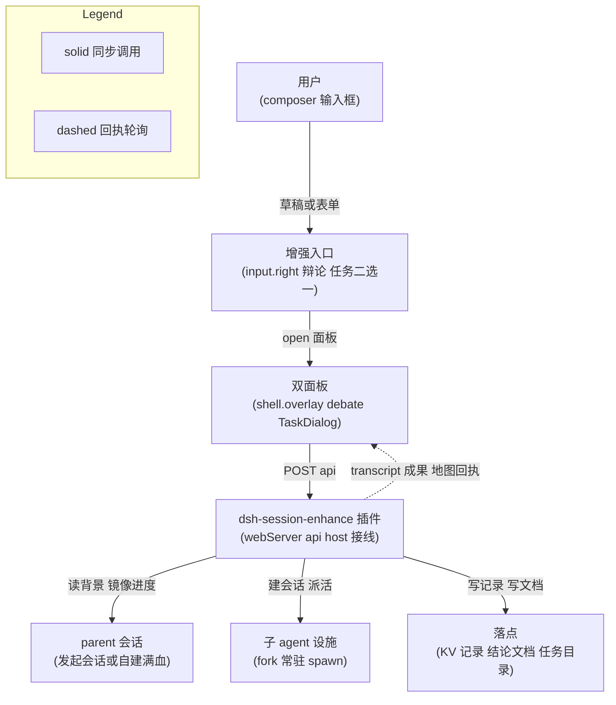
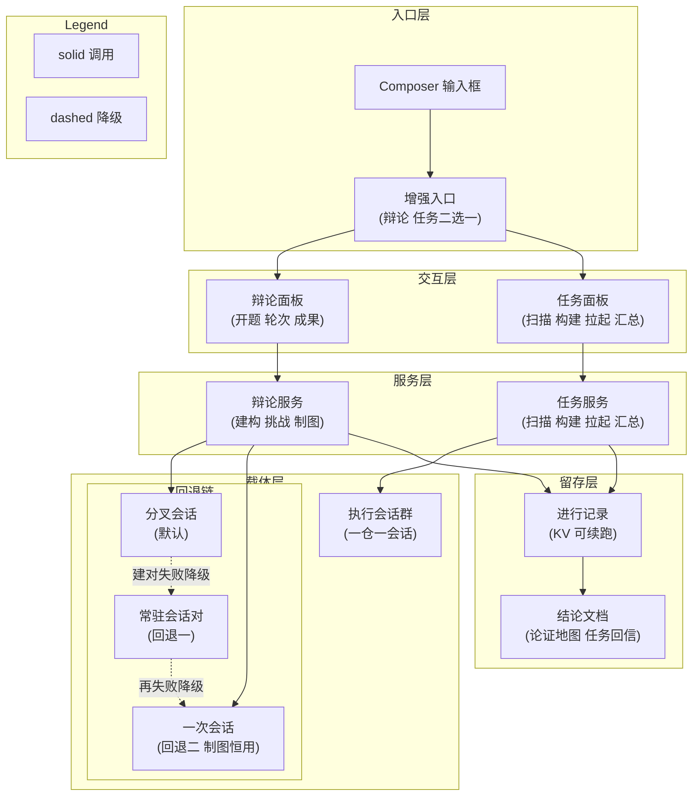

# dsh-session-enhance Architecture Description

> Provenance: `arch` retrofit on a brownfield DSH native plugin (2026-09-30);
> 跨仓任务并入见 ADR-0025（2026-10-20），单线分叉见 ADR-0024；v0.14.0 全量更名 + 去模型工具（人工操作插件，`contributes.tools` 为空）。
> Zero-invention: every statement traces to `GLOSSARY.md`, `docs/adr/0001~0029`, or the code in `src/`.
> Split record (S28, 2026-10-22): 本文件退为全工程总览入口；debate 详述见
> `docs/architecture-debate.md`，cross-tasks 详述见 `docs/architecture-cross-tasks.md`。
> 两份分文档各按 arch 七节 + md-diagram 自查写全静态结构与主流程，本文件只保留总图、映射与指针，不再复述文件名级细节。
> Merge record (S20): vitest 行为门 `test/` 与 pytest 治理门 `tests/` 合并为单一 `tests/` 布局
> （`tests/vitest/` 行为 + `tests/governance/` 架构 + `tests/<module>/` 镜像）；`docs/test_index.md`
> 从"只登治理门"扩为"两扇门总目录"。`npm run test:sandbox` 跑合并后同一套文件。
> Merge record (S22 对称)：辩论纯逻辑从 `src/*.ts` 平铺搬入 `src/debate/`（`debate.ts`/`lenses.ts`/`persist.ts`），
> 与 `src/cross_tasks/` 平级对等；`src/version.ts` 留顶层共享（host/client 共用）；host 接线仍在 `src/index.ts`
> （单 tsdown entry，平台约束不变）。红线 SYM-01 + DEBATE-01 落 TOML（v0.14.0 去模型工具：WIRE-01 改守路由面，CAGE-01/SYM-01 续守笼与符号面），`tests/src/debate/` 镜像随行。
> S27 host 内聚：工具笼（`host/cage.ts`）与常驻辩手对（`host/resident.ts`）从 `src/index.ts` 摘出，
> index 只留路由表 + 重导出（单 tsdown entry 约束不变）；tests 直连 `src/host/*`，不再穿 index 缝。

## 1. Identification and Scope

- **System Name**: dsh-session-enhance (doubleelec native DSH plugin `elec-session-enhance`).
- **Functions**: 两个入口、两套 host 接线、一套面板外壳——
  - **辩论**：为开放性论证题跑建构 / 挑战 / 制图三角色，产出一套固定五件套成果地图，而非单一结论句。详述见 `docs/architecture-debate.md`。
  - **跨仓任务**：扫一父目录下多仓结构（scan）→ AI 按任务描述推荐涉及仓、人审核勾选（recommend，ADR-0028；失败透出诊断，ADR-0029）→ 建任务材料目录（build，人审改 issued）→ 一仓一会话拉起执行（launch）→ 回信汇总（report/collect），见 ADR-0025/ADR-0028/ADR-0029。详述见 `docs/architecture-cross-tasks.md`。
- **Scope**: `src/` 下的 host 半区（webServer 路由 + 辩论循环与跨仓任务接线，不注册模型工具）与浏览器 bundle（overlay 对话框 + 输入框入口 + 双面板）。测试单列 `tests/`（§7：vitest 行为门 + pytest 治理门，两扇门一处放）；部署与发包在圈外（见 spec Out of Scope）。
- **Two functions, one seam**: 辩论（`src/debate/` 纯模块 + `src/index.ts` 内 deliberation 接线）与多仓任务（`src/cross_tasks/` 纯模块 + `src/index.ts` 内 task 接线）是**平级对等目录**（S22 对称，各管各的纯逻辑；`src/version.ts` 共享）。接线层平台强制同文件（tsdown entry 单 `src/index.ts`、路由表在 `apply()` 逐条注册）。S27 摘出 host 内聚两件（不碰路由表）：工具笼 → `src/host/cage.ts`，常驻辩手对 → `src/host/resident.ts`；`index.ts` 只留路由表 + 重导出（兼容旧 import 面），tests 直连 `src/host/*`。

## 2. Stakeholders and Concerns

- **提问者（最终用户）**: 只想点一下就开辩论，不填表单；要看到辩论过程可读、可审计；最终拿地图自己做判断。
  - **Concerns**: 入口无缝（ADR-0008），过程可读，产物忠实（ADR-0001/0002）。
- **多仓任务发起人（同一用户，任务视角）**: 一父目录下多仓并行推进，任务材料人审后再拉会话，不拉空模板会话。
  - **Concerns**: 结构先看清（scan 分组可勾），材料先审后发（issued 门），一仓一会话可跟进（launch 回 sessionId），回信可汇总（report/collect）。
- **插件维护者**: 改判定逻辑不回归，host 注册失败可观测，重启不丢可诊断信息。
  - **Concerns**: 协议纯函数可单测（spec 缝一），路由契约可查（`/api/debug*`），架构漂移被门拦住。
- **DSH 部署**: 插件不得扩权（`restrict` 单向收窄），不得改 preset 文件，不得发包到 prod。
  - **Concerns**: 工具笼只收窄（ADR-0022），`standard` preset 部署所有。

## 3. Quality Attribute Scenarios (QAS)

- **QAS-1 可读性**: 5 轮辩论（约 13 次子调用，每方 4000+ 字）落进 720px 对话框时，提问者 30 秒内能说出"谁让了什么、新增了什么"。驱动分段折叠（摘要默认展开、论证折叠）。详见 debate 篇 §3。
- **QAS-2 可审计性**: 任何"已一致/分歧"结论都能回跳到 `[R轮 #seq 角色]` 原文；中断原因（超时/人停/模型拒活）实报，不吞成 `aborted`。详见 debate 篇 §3。
- **QAS-3 不丢不卡**: 子 agent 调 `ask_user_question` 或大海捞针时必失败、不无限卡 `round=-1`；开题一边挂了另一边的内容保留。常驻轮次用进度感知超时（4 分钟无新事件判 `stalled`，20 分钟硬顶判 `timeout`）。详见 debate 篇 §3。
- **QAS-4 满血只读**: 辩手能读文件/检索/联网查证（31 工具继承链），但写不了文件、执行不了 shell、套不了娃（白名单笼：辩手 6 项、制图员 3 项，ADR-0022）。详见 debate 篇 §3。
- **QAS-5 接管可见**: 辩论期间发起会话空闲可说话（host 后台直驱，不占 turn）；忙闲每轮采样可见、一键双停停两边、打断点在实录可指（ADR-0023）。详见 debate 篇 §3。
- **QAS-6 单线零污染**: 默认单线分叉跑在 fork 子会话里（种子继承发起会话上下文，主会话只收转述+摘要）；辩论结束分叉扫掉，只留结论文档（ADR-0024）。详见 debate 篇 §3。
- **QAS-7 任务先审后发**: scan 先看清结构（repo/part/external/unknown 分组）；打开面板自动扫并推荐（cwd 默认、AI 按任务描述推荐涉及仓 + 理由展示，判不出回空选 + 提示手勾），用户审核勾选后再 build；build 写材料目录后直接进预览——逐仓列出"仓→cwd→provider/model"，确认才拉起（确认即签发，`skipIssuedCheck` 直发，directive 照常写盘留痕）；stop 能 abort 未完成的拉起（已冒出的会话不回收，人去会话列表跟进）。详见 cross-tasks 篇 §3。

## 4. Viewpoints and Views

### 4.1 Context View

- **Purpose**: 插件在 DSH 里只占三个槽位 + 一组 HTTP 路由，不碰会话主循环。黑盒只讲边界；两条线的走法是内部细节，见两份分文档 §4.4 时序。
- **Model/Diagram**:

- **Elements**: 黑盒外只有三样：发起会话（读背景/写镜像）、子 agent 设施（`ctx.subagents` spawn、`ctx.agents` 建分叉/常驻）、浏览器（轮询 state）。两条线的走法在内部分：辩论见 `docs/architecture-debate.md` §4.4，任务见 `docs/architecture-cross-tasks.md` §4.4。

### 4.2 Logical Decomposition View

- **Purpose**: 职责分层一张图：入口 / 交互 / 服务 / 载体 / 留存。图里只讲职责、不带文件名——"哪个职责落在哪个目录"见 §4.3 映射表，文件名索引与判定链见两份分文档 §4.2 Elements。
- **Model/Diagram**:

- **Elements（总览级，细节见分文档）**:
  - 辩论服务：三角色 + 三载体（单线默认 / 常驻回退一 / 一次性回退二）+ 停机三条件 + 留存双路径（KV + 结论文档）。静态组成与判定链见 `docs/architecture-debate.md` §4.2。
  - 任务服务：四纯模块（scan / materials / ensure-session / recommend）+ 8 路由 + issued/ASCII 门 + 三道门拉起。静态组成与五步流程见 `docs/architecture-cross-tasks.md` §4.2/§4.4。
  - 共享：`src/version.ts` 版本真值（host/client 共用）；面板外壳（双 Dialog 同 overlay，随 host 同构建同发布）。

### 4.3 Module Documentation Map

| Module | Docs bucket | Reason | Module doc paths |
| ------ | ----------- | ------ | ---------------- |
| `src` | top-level only | host 接线：路由注册/辩论循环 + task 接线（单 tsdown entry，同文件逐条注册；host 内聚件见 `src/host`） | - |
| `src/host` | top-level only | host 内聚：工具笼（cage.ts）+ 常驻辩手对（resident.ts）+ 共享面（types.ts）；index 只重导出 | - |
| `src/client` | top-level only | 交互层：DebateDialog + TaskDialog 双面板，同 overlay；随 host 同构建同发布 | - |
| `src/debate` | own pair | 辩论服务纯逻辑独立演进（协议 v1~v7、焦点账本、审计链），有独立 vitest 镜像与红线 | `docs/architecture-debate.md`, `docs/action-plan.md` |
| `src/cross_tasks` | own pair | 任务服务纯逻辑独立演进（scan/materials/ensure-session/recommend），有独立 vitest 镜像与红线 | `docs/architecture-cross-tasks.md`, `docs/action-plan.md` |
| `src/version.ts` | top-level only | 共享：版本真值（host/client 共用，`src` 直属文件） | - |

- **Coverage note**: `arch` TOML 覆盖是全量的（v0.14.0 起 `contributes.tools` 为空、路由前缀 `/dsh-session-enhance/api/`）（`src` + 嵌套 `src/client`、`src/debate`、`src/cross_tasks`、`src/host`）；测试单列 `tests/`（§7：vitest 行为门 + pytest 治理门，两扇门一处放，不再分 `test/`/`tests/` 两目录）。
- **Naming (S23, v0.14.0 修订)**: 内部目录 `src/cross_tasks/` vs 公开面 `/api/task/*`——目录名取自废弃原型腾出的 `cross-tasks`（snake 式），公开面保持 `task` 路径；模型工具名已随人工操作化删除（breaking 边界：路由/manifest 为空工具表，旧注册名作废）。文档里"跨仓任务"泛指功能，`cross_tasks` 特指代码目录，`cross-tasks`（kebab）仅指被废弃的原型实例目录，不混用。

### 4.4 Runtime/Concurrency View

- **Purpose**: 两条线的时序各走各的——辩论（现行单线分叉，常驻/one-shot 为回退）与任务（scan→recommend→build→launch→report/collect 显式五步，无回退链）。时序图与判定细节已下沉到分文档，本节只保留一句话指针。
- **Debate**: 建单即后台直驱 open→round×N→synthesize，全串行；载体三档按 single→resident→oneShot 降级，`residentError` 记整条链。时序与停机判定见 `docs/architecture-debate.md` §4.4。
- **Task**: 打开自动扫、AI 推荐人审核、预览确认后直发，无后台直驱、无回退链；stop 只 abort 未完成的拉起，已冒出的不回收。五步时序与面板状态机见 `docs/architecture-cross-tasks.md` §4.4。

### 4.5 Deployment/Physical View

- **Purpose**: 单包双 bundle，dev 联调用 3090；辩论与任务同一包发布，无独立发版节拍。
- **Elements**: `lib/index.js`（host：deliberation 接线 + task 接线）+ `lib/client.js`（bundle：辩论 Dialog + TaskDialog 双面板同 overlay，经 `dsh.client` 声明）；`cordis.patch.yml` 插入组合；`dsh.plugin.json` 声明**零模型工具**（人工操作插件，`contributes.tools` 为空）与三槽位（overlay/input.right + 设置节）。dev 用 `dsh --profile dev --port 3090 --no-open`，client 硬刷（Ctrl+Shift+R）。

### 4.6 Security View

- **Purpose**: 插件只读不写：辩手满血读证据，但写盘/执行/套娃三条路焊死；任务材料先审后发。
- **Elements**: 工具笼白名单（ADR-0022：辩手 6 项、制图员 3 项，fail-closed；启动交集核对；scope-local 走执行期 guard；`tools.restrict` 单向收窄）；跨仓任务接线 ASCII 门（`assertTaskAscii`：路径/仓名先验字符集，防注入）；模板真身调用方显式传（`templateDir`/文本二选一，不从调用会话 cwd 猜）；launch 三道门 + issued 门（directive 非 issued 拒收；确认即签发带 `skipIssuedCheck`，directive 照常写盘留痕；issued 门只拦外部直调）；原生发送键只许碰 `setDraft`（建单后清空草稿），`submit` 及其他键面板代码禁触。

## 5. Architecture Decisions

- [ADR-0001](adr/0001-map-not-verdict.md): 产物是地图而非结论句。
- [ADR-0002](adr/0002-three-roles.md): 建构/挑战/制图三角色分离，裁判默认关。
- [ADR-0003](adr/0003-hybrid-lens.md): 视角模板保下限、动态拔上限、人审保方向。
- [ADR-0004](adr/0004-saturation-stop.md): 停在覆盖饱和而非共识收敛（排他性表述已被 ADR-0014 修正）。
- [ADR-0005](adr/0005-claim-layering.md): 断言先分事实/推理/价值三层。
- [ADR-0006](adr/0006-synthesizer-reuse.md): 制图员复用辩手模型时新会话即算独立。
- [ADR-0007](adr/0007-context-pack.md): 背景包只进辩手不进制图员。
- [ADR-0008](adr/0008-auto-resolve.md): 入口只留三模型，问题与背景全自动。
- [ADR-0009](adr/0009-stepwise-tools.md): 分步工具将会话直播（已被 host 直驱继承）。
- [ADR-0010](adr/0010-tool-registration.md): 工具注册三硬伤与 `/api/debug` 可观测。
- [ADR-0011](adr/0011-host-driven.md): host 直驱，点开始就自动跑。
- [ADR-0012](adr/0012-full-parent.md): 自建 parent 挂默认 preset，子 agent 满血的优雅通道。
- [ADR-0013](adr/0013-resident-debater.md): 常驻辩手 + 交棒结论，替代一次性起辩。
- [ADR-0014](adr/0014-stop-conditions.md): 停机三条件（共识/饱和/跑满）+ 判定输入落盘，修正 ADR-0004 的排他表述。
- [ADR-0015](adr/0015-handoff-slimming.md): 交棒载荷瘦身——跨轮传摘要（-87%），同轮传全文。
- [ADR-0016](adr/0016-audit-protocol.md): 停机信号协议版本化（B5）+ 片段级引用审计（B6，下限估计）+ 面板/实况审计展示联调。
- [ADR-0017](adr/0017-focus-ledger-and-closing-statement.md): 协议 v4——未决清单焦点账本 + 新增判定只看「本轮变化」段 + 篇幅预算 + 对话区镜像摘要 + 收尾陈述（决策摘要/兜底）。
- [ADR-0018](adr/0018-version-truth.md): 版本真值——构建期内联 + 三方对账；徽标显示正在跑的版本，取不到时显示 `v?` 而非冒充新版本。
- [ADR-0019](adr/0019-conclusion-persistence.md): 结论落盘——整局记录进 KV 单元 `dsh_session_enhance`（per-record）、结论文档进 `<工作区>/docs/session-enhance/`；恢复的局只读且把半途的标成已中断；两条失败原因分开可见。
- [ADR-0020](adr/0020-cap-convergence.md): 压线共识——上限处一致是 convergence 的修饰位（`convergedAtCap`），只改说法不改停机；镜像/兜底收尾/面板审计三处标"压线"并给加轮复验建议。
- [ADR-0021](adr/0021-optional-audit-versioning.md): 可选审计字段不 bump 记录版本——只有不兼容变更才 +1；`pointerAudit` 为判例（`?` 可选 + 缺即 unknown + 只审计不 gate）。
- [ADR-0022](adr/0022-tool-cage-allowlist.md): 工具笼改白名单——deny 黑名单 fail-open（新工具默认放行），allow 白名单 fail-closed；辩手 6 项、制图员 3 项；启动交集核对（失效剔除、空集失败）、scope-local 走执行期 guard、生效笼型进已启动行 + 落盘（可选审计字段）。
- [ADR-0023](adr/0023-session-takeover-b.md): 会话接管 B 方案——忙快照 + 一键双停 + 打断可映射（旧局落盘/新局可见/面板画线）。
- [ADR-0024](adr/0024-single-thread-fork.md): 单线分叉——单模型双角色交替线（互盲拿掉：挑战者能看到建构原文逐条反驳；载体用分叉保主会话零污染；种子照抄原生 fork；防呆 `isRouteIneffective` 豁免单线）。
- [ADR-0025](adr/0025-task-merge.md): 增强入口与跨仓任务并入——输入框按钮改"✦ 增强"弹菜单（辩论/多仓任务），原生发送键不借用（`inputActions` 全仓只有 `setDraft`）；task 三纯模块并入 `src/cross_tasks/`（S23 由 `src/task/` 改名，原型废弃后腾名），路由挂 `/dsh-session-enhance/api/task/*` 8 条，模型工具零个（人工操作插件，面板 HTTP 路由驱动），launch 三道门 + issued 门照抄 launcher。
- [ADR-0026](adr/0026-task-autofill-preview.md): 任务面板打开即扫 + 预览即确认门——父目录默认只用当前会话 cwd（偏好旧值忽略防串台），repo 全勾/牵头首个/slug 自拟自动回填（⚠️ 回填部分已被 ADR-0028 作废：scan 只展示，涉及仓由推荐定）；"扫描结构"按钮改为"重新扫描"；build 成功直接进预览（逐仓"仓→cwd→provider/model"），确认才 launch（确认即签发带 `skipIssuedCheck`，issued 门只拦外部直调）。
- [ADR-0028](adr/0028-task-recommend-review.md): 任务面板 AI 推荐涉及仓 + 入口前置草稿门——`task/recommend` 按任务描述推荐涉及仓（只给推荐 + 理由 + 标题，人审核；判不出回空选 + 手勾）；入口改名"✦ 增强会话"，空草稿整钮禁用（有意反转 ADR-0025 可达性）；WIRE-01 task 路由 7→8 条。（部分被 ADR-0029 作废：牵头取首个 + 标题机制。）
- [ADR-0029](adr/0029-task-no-lead-slug-desc.md): 去牵头仓 + slug 按任务 + 去标题字段——协调位即任务目录自身（directive `lead:` 写 none）；slug 从描述/AI 标题经 `suggestSlugFromText` 定（不再从父目录取工程名）；留任务描述去一句话标题（标题位直接用描述，截 80）；recommend 成功/失败透出 stopReason/rawLen（失败带 rawHead）供排障。
- [ADR-0030](adr/0030-recommend-context-and-log.md): 推荐链补上下文与可观测——候选仓带一行自述（`candidates.ts`：package/module.toml/README/目录），模型输出写法宽容归一（`normalizeRepoRef`/`matchRecommended`），空推荐回候选清单 + 原文，推荐尝试进 20 条环形缓冲并开只读路由 `task/recommend/log`（WIRE-01 8→9 条），排障走 `scripts/probe-recommend.mjs` 直打真实 host（部分修订 ADR-0028：候选不再只给路径）。
- [ADR-0031](adr/0031-task-panel-controls-and-defaults.md): 任务面板控件与缺省——去"重新扫描"/"重新推荐"（父目录、描述失焦即重算）、加"取消"、勾选区只列真仓（unknown/external 收进一行忽略提示）、去"默认 .tasks"按钮（scan 直接填）、provider/model 改下拉（新增只读路由 `task/models`，取不到退化为手输）、模板内建（`DEFAULT_DIRECTIVE_TEMPLATE`/`DEFAULT_TO_TEMPLATE`，消灭父目录找模板的 ENOENT；WIRE-01 9→10 条）。
- [ADR-0032](adr/0032-no-silent-degradation.md): 能力缺失是缺陷不是退化理由——`llm` 是宿主 Context 服务（`listProviders`/`listModels`），取不到即接线缺陷，`task/models` 回 `ok:false` 让面板报错而不是退化为手输；适配器不广告模型（合法能力差异）收进 `providerErrors` 点名，只有该情形才允许手填 model id。以"以防万一"为由的静默兜底一律按缺陷处理。
- [ADR-0033](adr/0033-slug-from-ai-and-task-dir.md): slug 由 AI 拟（`{"slug":"cleanup-tmp"}`，2-3 词、≤20 字符，`sanitizeTaskSlug` 归一，词表启发仅作兜底），任务根目录缺省改 `<父目录>/.cross-tasks` 并显示完整任务目录预览，模板目录降级进"高级"并解释其用途，建任务与取消两键等权。

## 6. Constraints and Risks

- **Technical Constraints**: `tools.restrict` 单向收窄——插件能禁不能加；allow/deny 只动全局层（scope-local 名列了就抛 unknown，实测）：`subagent` 走执行期 guard；`conversation.input.right` 空 props——sid 必须走 overlay 的 `useSessions.current`；单 tsdown entry 约束 host 接线同文件。
- **Business Constraints**: 不改部署的 `standard` preset 文件；不发布 prod（3080）与 npm。
- **Identified Risks**:
  - 辩论：常驻辩手 context 膨胀 → 跨轮交棒瘦身（`slimHandoff`，实测 -87%）；饱和启发式假阳性（整篇找信号词 10/10 误判）→ 只看本轮变化段 + 焦点停滞；模型不守约输出 `待决清单=` → 三态解析保证退化方向是多辩几轮；provider 抖动 → 同会话有界重投 3 次；固定超时误杀长轮次 → 进度感知超时。详见 debate 篇 §6。
  - 任务：推荐判不出 → 空选 + 手勾不阻塞；involved 路径映射错 → build 即验落点；模板占位残留 → 报错不写半成品；同秒重调撞 stamp → 60s bump；已冒出会话 stop 停不掉 → 语义写死不回收。详见 cross-tasks 篇 §6。
  - 内存会话表重启即清 → KV 持久化已落地（ADR-0019）；恢复的局只读不续跑。

## 7. Test Architecture

- **Vocabulary**: unit test 管一个 ticket，integration test 管一个 spec，system test 管两个以上 spec / 整 effort。常驻辩手 effort 的 system test 跑"真 1 轮辩论端到端"（单线分叉 + 制图，断言 transcript 结构与交替链不断）。
- **Tools**: vitest（`tests/vitest/`，246 用例：协议纯函数 + 回合推进 + 单线分叉 + 落盘往返 + 面板分段 + task 六件：scan/materials/ensure-session/routes/panel/recommend）；pytest（`tests/governance/` vendored 三件套 + `tests/<module>/` 真红线绑定）；`arch_engine.py check`（TOML/孤儿/幻影/漂移门）；沙箱内 vitest 起不来（spawn EPERM）时用 `scripts/test-sandbox.mjs` 编译并执行同一份测试文件（垫片遇到未实现的 matcher 抛错而非静默通过）。
- **Directory layout**: 单一 `tests/`：`tests/vitest/` → vitest 真用例（行为门：协议/回合/单线分叉/落盘/面板）；`tests/governance/` → 只读 vendored 门（架构门，动不得：orphan/phantom/kit 完备/meta-index）；`tests/<module>/`（`src`/`src/client`/`src/debate`/`src/cross_tasks`/`src/host`）→ 模块真红线绑定（`test_invariants.py` 活门）；`docs/test_index.md` → 两扇门总目录（行为 + 治理各一行）；`.tmp/` → 沙箱替代校验脚本与真跑 state（gitignored，可清）。pytest 产物（`__pycache__/`、`.pytest_cache/`）是运行期垃圾，不在治理内（见 `.gitignore` 约束）。
- **Layer-scope overrides**: 本 effort 单 spec 跨 host+client 双 bundle，其 integration gate 按 system-grade 跑（真起子 agent 读文件，见笼子验证局），已在 `docs/action-plan.md` Wave 1 注记，不静默。
